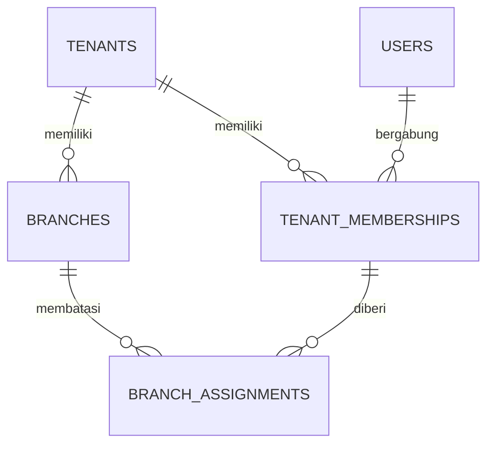
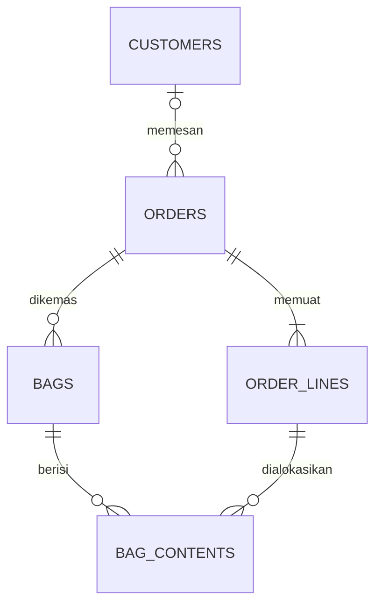
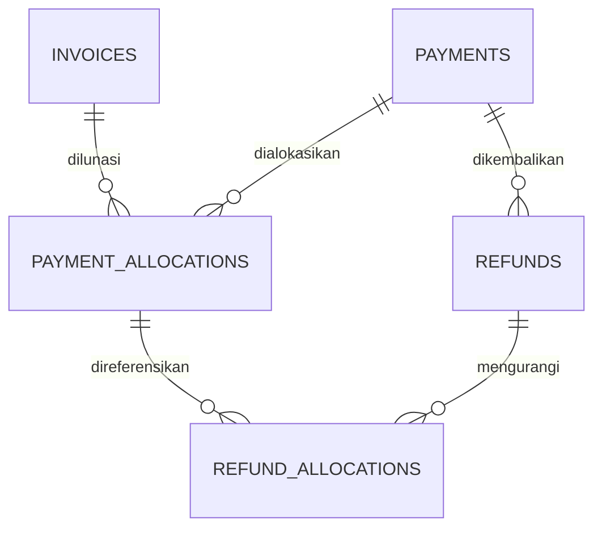
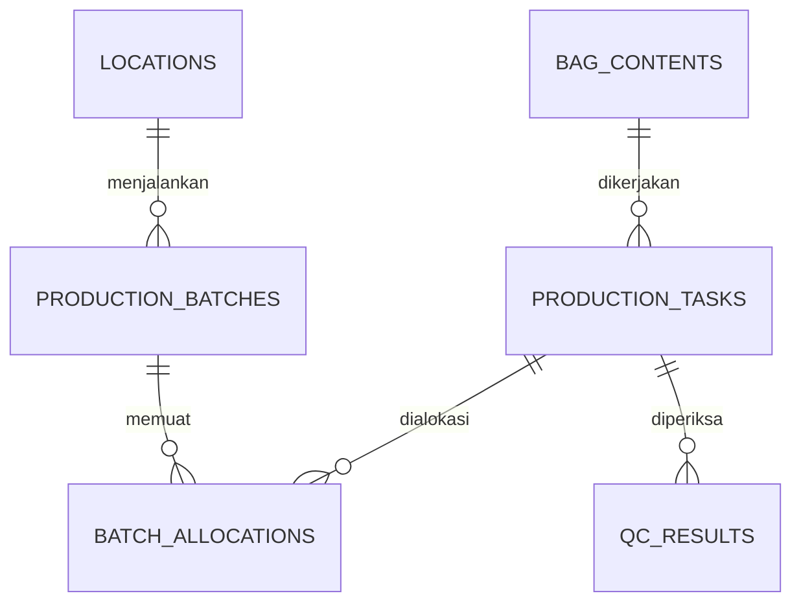
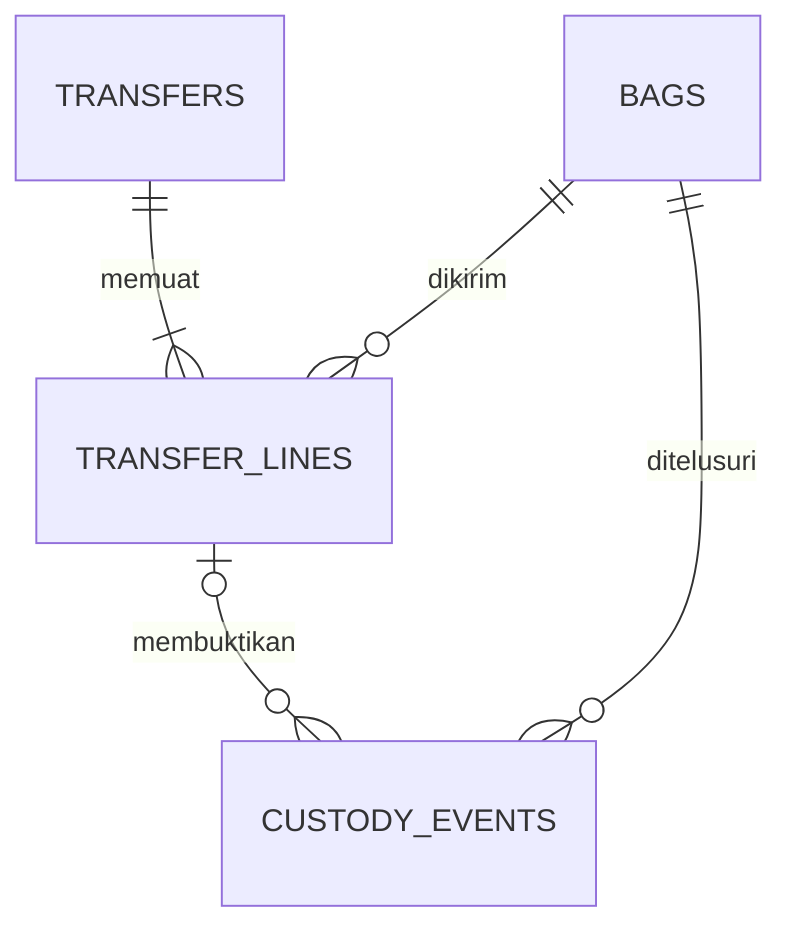

# Skema Database Laundry SaaS

Versi 1.1 · 28 Oktober 2026 · Status usulan untuk implementasi

[PRD](prd.md) · [TRD](trd.md) · [Database](erd.md) · [UI UX](ui_guidelines.md) · [Aturan AI](agents.md) · [Keamanan](security.md) · [Rencana](todo.md)

## 1 Status dan konvensi

Schema berikut merupakan model logis yang cukup rinci untuk menulis migration Laravel. Ini bukan dump SQL atau klaim database sudah dimigrasikan. Nama tabel, tipe, constraint, dan aturan antarbaris menjadi acuan bersama; implementasi diverifikasi pada PostgreSQL. Kolom umum di bawah diwariskan sesuai kelas tabel dan tidak diulang di setiap kamus.

| Kelas | Kolom umum dan karakter |
|---|---|
| G global | `id bigint generated by default as identity PK`, `public_id uuid UNIQUE NOT NULL`, `created_at timestamptz`, `updated_at timestamptz`, `version bigint default 1` |
| D tenant mutable | Kolom G ditambah `tenant_id bigint NOT NULL FK tenants(id)` dan `UNIQUE(tenant_id,id)`; version untuk optimistic concurrency |
| L tenant append only | `id bigint identity PK`, `public_id uuid UNIQUE NOT NULL`, `tenant_id bigint NOT NULL`, `created_at timestamptz`, `UNIQUE(tenant_id,id)`; tanpa updated_at dan version |
| C control plane tenant | Bentuk kolom D, tetapi akses melalui layanan platform atau identity yang dibatasi; tidak tersedia sebagai CRUD tenant bebas |
| J join atau counter | Hanya `tenant_id` dan kolom yang disebutkan, dengan PK gabungan yang dinyatakan; tidak otomatis mendapat id atau public_id |

Semua kolom tidak nullable kecuali bertanda `null`. Varian G append only pada tabel pendukung menghapus updated_at dan version serta melarang update atau delete melalui role aplikasi. UUID dibuat server; client command UUID disimpan terpisah. Bigint dipakai untuk FK internal, UUID untuk API. Identifier publik tidak menggantikan authorization. Nilai uang integer rupiah dan kuantitas `numeric(12,3)`; waktu `timestamptz` disimpan dan diproses sebagai UTC, sedangkan tanggal bisnis ditafsirkan berdasarkan zona cabang.

FK tenant parent selalu berbentuk `(tenant_id,parent_id)` menuju `(tenant_id,id)`, bukan FK parent_id saja. Kolom umum L immutable; event koreksi menambah baris baru. Tabel D keuangan yang menjadi state machine seperti refund boleh berubah status, tetapi fakta dana succeeded dan histori peralihannya tidak boleh dihapus.

## 2 Hubungan inti

### Organisasi dan akses



### Layanan dan unit fisik



Cardinality ORDER_LINES di diagram menggambarkan order accepted. Draft dapat belum mempunyai line dan akan ditolak saat accept bila belum lengkap.

### Dana dan alokasi



### Produksi



### Transfer



Manifest draft dapat belum memiliki line. Diagram tidak menampilkan seluruh FK tenant agar tetap mudah dibaca; FK tersebut tetap wajib menurut kamus.

## 3 Prinsip jumlah uang dan barang

- Satu order line adalah dasar layanan yang ditagih. Satu bag adalah wadah, bukan invoice line baru.
- Seluruh alokasi fisik memakai measured quantity. Minimum tertagih tidak membuat stok pakaian tambahan.
- Invoice bisa memuat beberapa order pada P1 B2B melalui invoice_lines. Unique sumber layanan mencegah tagihan ganda.
- Payment hanya mencatat penerimaan yang sah; attempt pending tidak termasuk paid.
- Refund mengembalikan dana, adjustment mengubah tagihan, allocation reversal melepas alokasi tanpa memindahkan uang.
- Ledger tetap berada dalam tenant yang sama; dana merchant platform tidak masuk kas tenant.

## 4 Kamus tabel identitas dan organisasi

### `tenants`

Fase **P0** · Kelas kolom **G**.

| Kolom tambahan | Tipe | Aturan dan fungsi |
|---|---|---|
| `name` | `varchar(150)` | Nama organisasi |
| `slug` | `varchar(80)` | Unik; bukan dasar otorisasi |
| `timezone` | `varchar(64)` | Default Asia/Jakarta |
| `status` | `varchar(24)` | provisioning, active, suspended, closed |
| `data_generation` | `bigint` | Naik saat resync menyeluruh diperlukan |

**Constraint dan relasi:** `slug` unik; tenant tidak mempunyai tenant_id yang menunjuk dirinya sendiri. Penghapusan memerlukan proses retensi, bukan cascade massal.

**Catatan implementasi T009:** `provisioning_requests` adalah tabel control plane dengan unique `(user_id, client_command_id)`, hash payload, status terminal, dan referensi tenant/cabang/membership. RLS membatasi baris ke `app_current_user_id()`. Role runtime tidak dapat menghapus request. Tenant baru dibuat setelah ID dialokasikan dan tenant context diaktifkan, sehingga policy tenant normal tetap berlaku.

### `users`

Fase **P0** · Kelas kolom **G**.

| Kolom tambahan | Tipe | Aturan dan fungsi |
|---|---|---|
| `name` | `varchar(150)` | Identitas akun platform |
| `email` | `varchar(254)` | Normalisasi dan unique menurut kebijakan login |
| `password` | `varchar(255)` | Hash framework; bukan plaintext |
| `email_verified_at` | `timestamptz null` | Verifikasi email |
| `mfa_secret_ref` | `text null` | Referensi secret terenkripsi |
| `status` | `varchar(24)` | active, disabled |

**Constraint dan relasi:** Email unik bila menjadi identifier login. Pengguna tidak menyimpan satu tenant_id tetap; keanggotaan ada di tenant_memberships.

**Catatan transisi implementasi T008:** Tabel `users` framework dievolusikan melalui migration tambahan: public UUID di-backfill per batch lalu dibuat nonnull/unique dengan default server; status, version, dan field MFA ditambahkan; timestamp lama dikonversi ke timestamptz dengan asumsi penyimpanan UTC yang eksplisit. Untuk kompatibilitas data lama, PK internal bigserial, panjang nama/email 255, serta nullable created_at/updated_at dari migration framework dipertahankan. Batas input produk 150/254 tetap menjadi kontrak action/API saat endpoint dibuat; pengetatan DDL lanjutan memerlukan pemeriksaan dataset dan rollout T079. Tabel domain baru memakai identity bigint, UUID publik, FK tenant gabungan, dan timestamp berzona sesuai konvensi di atas. Backfill dan pemeliharaan identitas/password/waktu pengguna lama dibuktikan pada test T008, bukan diasumsikan dari diagram.

### `tenant_memberships`

Fase **P0** · Kelas kolom **C**.

| Kolom tambahan | Tipe | Aturan dan fungsi |
|---|---|---|
| `user_id` | `bigint` | FK users |
| `status` | `varchar(24)` | invited, active, disabled |
| `permission_version` | `bigint` | Default 1; naik saat izin atau assignment berubah |
| `invited_by_user_id` | `bigint null` | FK users |

**Constraint dan relasi:** Unique `(tenant_id,user_id)`; bootstrap hanya boleh mencari pasangan tenant kandidat dan user login melalui identity resolver terbatas.

### `roles`

Fase **P0** · Kelas kolom **D**.

| Kolom tambahan | Tipe | Aturan dan fungsi |
|---|---|---|
| `code` | `varchar(64)` | Contoh cashier atau owner |
| `name` | `varchar(100)` | Label yang ditampilkan |
| `is_system` | `boolean` | Role bawaan dapat dibatasi pengubahannya |

**Constraint dan relasi:** Unique `(tenant_id,code)`. Peran tidak memberikan akses tanpa membership dan scope.

### `permissions`

Fase **P0** · Kelas kolom **G**.

| Kolom tambahan | Tipe | Aturan dan fungsi |
|---|---|---|
| `code` | `varchar(100)` | Contoh orders.create, payments.refund.approve |
| `description` | `text` | Makna tindakan |

**Constraint dan relasi:** `code` unik. Daftar permission dikelola melalui rilis aplikasi, tidak diisi bebas oleh pengguna.

### `membership_roles`

Fase **P0** · Kelas kolom **J**.

| Kolom tambahan | Tipe | Aturan dan fungsi |
|---|---|---|
| `membership_id` | `bigint` | FK tenant_memberships pada tenant sama |
| `role_id` | `bigint` | FK roles pada tenant sama |

**Constraint dan relasi:** PK `(tenant_id,membership_id,role_id)`; tidak memiliki kolom umum id atau public_id.

### `role_permissions`

Fase **P0** · Kelas kolom **J**.

| Kolom tambahan | Tipe | Aturan dan fungsi |
|---|---|---|
| `role_id` | `bigint` | FK roles pada tenant sama |
| `permission_id` | `bigint` | FK permissions global |

**Constraint dan relasi:** PK `(tenant_id,role_id,permission_id)`.

### `branches`

Fase **P0** · Kelas kolom **D**.

| Kolom tambahan | Tipe | Aturan dan fungsi |
|---|---|---|
| `code` | `varchar(20)` | Kode nota outlet |
| `name` | `varchar(150)` | Nama cabang |
| `timezone` | `varchar(64)` | IANA timezone |
| `address` | `text` | Alamat operasional |
| `phone` | `varchar(32) null` | Kontak outlet |
| `is_active` | `boolean` | Cabang nonaktif tidak menerima pesanan baru |

**Constraint dan relasi:** Unique `(tenant_id,code)`; kode sudah dipakai pada nota tidak diganti tanpa strategi alias.

**Catatan implementasi T012:** Profil, IANA timezone, dan `is_active` dapat diubah melalui endpoint tenant-scoped dengan `branches.manage`; version naik dan audit mencatat before/after serta alasan. Nonaktif tidak menghapus histori. `EnsureBranchAcceptsOrders` menjadi guard wajib bagi task order dan menolak cabang/tenant nonaktif.

### `locations`

Fase **P0** · Kelas kolom **D**.

| Kolom tambahan | Tipe | Aturan dan fungsi |
|---|---|---|
| `branch_id` | `bigint null` | FK cabang; null untuk pusat produksi independen |
| `code` | `varchar(40)` | Kode lokasi |
| `type` | `varchar(24)` | outlet, plant, warehouse, rack |
| `parent_location_id` | `bigint null` | FK lokasi induk dalam tenant |
| `name` | `varchar(150)` | Nama fisik lokasi |
| `is_active` | `boolean` | Status pemakaian |

**Constraint dan relasi:** Unique `(tenant_id,code)`; FK parent satu tenant; siklus lokasi dilarang application action dan diuji.

### `branch_assignments`

Fase **P0** · Kelas kolom **J**.

| Kolom tambahan | Tipe | Aturan dan fungsi |
|---|---|---|
| `membership_id` | `bigint` | Membership aktif |
| `branch_id` | `bigint` | Cabang yang diizinkan |

**Constraint dan relasi:** PK `(tenant_id,membership_id,branch_id)`; kedua FK gabungan tenant.

### `location_assignments`

Fase **P0** · Kelas kolom **J**.

| Kolom tambahan | Tipe | Aturan dan fungsi |
|---|---|---|
| `membership_id` | `bigint` | Operator atau manajer yang ditugaskan |
| `location_id` | `bigint` | Lokasi produksi atau gudang |

**Constraint dan relasi:** PK `(tenant_id,membership_id,location_id)`; scope lokasi tidak otomatis memberi izin uang.

## 5 Kamus katalog dan pelanggan

### `customers`

Fase **P0** · Kelas kolom **D**.

| Kolom tambahan | Tipe | Aturan dan fungsi |
|---|---|---|
| `name` | `varchar(150)` | Nama pelanggan |
| `normalized_phone` | `varchar(32) null` | Pencarian nomor konsisten |
| `email` | `varchar(254) null` | Kontak opsional |
| `external_ref` | `varchar(100) null` | Identitas sumber impor |
| `notes` | `text null` | Catatan operasional minimal |
| `is_active` | `boolean` | Nonaktif tetap mempertahankan histori |

**Constraint dan relasi:** Index `(tenant_id,normalized_phone)`; telepon bukan unique global dan dapat dipakai satu keluarga. Unique external_ref hanya dalam namespace sumber impor yang ditentukan.

**Catatan implementasi T023:** `customers` memakai metadata tenant UUID/version dan RLS. Nomor dinormalisasi ke format Indonesia berawalan `0`; pencarian memakai nama ILIKE atau normalized_phone, dengan cursor pagination. Duplikat hanya dicari dalam tenant yang sama. Endpoint update/nonaktif, fuzzy ranking, import, dan audit PII belum dibuat.

### `customer_addresses`

Fase **P0** · Kelas kolom **D**.

| Kolom tambahan | Tipe | Aturan dan fungsi |
|---|---|---|
| `customer_id` | `bigint` | FK customers |
| `label` | `varchar(60)` | Rumah atau kantor |
| `address` | `text` | Alamat |
| `latitude` | `numeric(10,7) null` | Opsional bila diperlukan layanan |
| `longitude` | `numeric(10,7) null` | Opsional |
| `is_default` | `boolean` | Alamat bawaan |

**Constraint dan relasi:** FK tenant; koordinat dalam batas valid. Atur paling banyak satu alamat default dengan partial unique index per customer.

**Catatan implementasi T023:** FK gabungan `(tenant_id, customer_id)`, CHECK latitude/longitude, dan partial unique index `(tenant_id, customer_id) WHERE is_default` diterapkan. Alamat pertama otomatis default; penggantian default dilakukan dalam transaksi dengan lock pada customer.

### `customer_consents`

Fase **P0** · Kelas kolom **L**.

| Kolom tambahan | Tipe | Aturan dan fungsi |
|---|---|---|
| `customer_id` | `bigint` | FK customers |
| `purpose` | `varchar(40)` | service_contact atau marketing |
| `channel` | `varchar(24)` | email, whatsapp, push |
| `decision` | `varchar(16)` | granted atau withdrawn |
| `source` | `varchar(80)` | Bukti atau kanal persetujuan |
| `occurred_at` | `timestamptz` | Waktu keputusan yang tercatat |

**Constraint dan relasi:** Append only; keadaan terbaru diturunkan dari histori. Penarikan promosi tidak menghapus bukti transaksi.

**Catatan implementasi T030 tahap diskon:** `discount_approvals` menyimpan requester, approver, persentase, status, alasan, dan waktu keputusan per quote; RLS tenant dan unique quote. Diskon ≤10% dapat auto-approved sesuai permission standar, sedangkan >10% memerlukan approver berbeda dengan permission override. Acceptance quote menolak approval pending/rejected.

**Catatan implementasi T024:** `customer_consents` memakai RLS tenant, FK gabungan customer, enum purpose `service_contact`/`marketing`, channel `email`/`whatsapp`/`push`, dan decision `granted`/`withdrawn`. Runtime hanya dapat SELECT/INSERT; koreksi dilakukan dengan event baru. API consent mengembalikan keadaan terbaru per pasangan purpose+channel, sedangkan histori order pelanggan memakai cursor `(created_at,id)` dan permission pelanggan serta order.

### `services`

Fase **P0** · Kelas kolom **D**.

| Kolom tambahan | Tipe | Aturan dan fungsi |
|---|---|---|
| `code` | `varchar(40)` | Identitas layanan |
| `name` | `varchar(150)` | Nama untuk kasir |
| `unit` | `varchar(16)` | kg, pcs, pair, meter, package |
| `minimum_quantity` | `numeric(12,3)` | Minimum tertagih, nonnegatif |
| `quantity_step` | `numeric(12,3)` | Kelipatan positif |
| `workflow_template_id` | `bigint` | Workflow bawaan |
| `is_active` | `boolean` | Publikasi katalog |
| `sla_mode` | `varchar(16)` | working_days atau elapsed_hours |
| `regular_turnaround` | `integer` | Hari kerja atau jam sesuai mode |
| `express_turnaround` | `integer` | Hari kerja atau jam sesuai mode |

**Constraint dan relasi:** Unique kode per tenant; step >0. Unit pcs, pair, package menerima kuantitas integral melalui validasi server.

### `price_books`

Fase **P0 P1** · Kelas kolom **D**.

| Kolom tambahan | Tipe | Aturan dan fungsi |
|---|---|---|
| `name` | `varchar(120)` | Nama daftar harga |
| `branch_id` | `bigint null` | Scope cabang; null untuk tenant |
| `customer_id` | `bigint null` | Kontrak pelanggan pada P1 |
| `is_active` | `boolean` | Status daftar |

**Constraint dan relasi:** FK tenant; prioritas customer+branch, customer, branch, tenant ditentukan eksplisit. Hanya satu book aktif untuk scope yang sama melalui partial unique index yang menangani nullable scope dengan benar. Kontrak customer P1 tidak diaktifkan diam diam pada P0.

### `price_entries`

Fase **P0** · Kelas kolom **D**.

| Kolom tambahan | Tipe | Aturan dan fungsi |
|---|---|---|
| `price_book_id` | `bigint` | FK price_books |
| `service_id` | `bigint` | FK services |
| `tier` | `varchar(24)` | regular atau express |
| `unit_price_rupiah` | `bigint` | Harga per unit ≥0 |
| `effective_from` | `timestamptz` | Awal inklusif |
| `effective_until` | `timestamptz null` | Akhir eksklusif |
| `rules` | `jsonb` | Konfigurasi minimum nominal dan komponen harga yang tervalidasi |

**Constraint dan relasi:** Periode valid; tidak boleh overlap pada book, service, tier yang sama. Gunakan exclusion constraint yang diuji atau lock parent dan pemeriksaan interval dalam seluruh jalur tulis; unique exact start saja tidak cukup.

**Catatan implementasi T022:** `price_books` dan `price_entries` memakai RLS serta FK gabungan tenant. Hanya satu book aktif untuk scope tenant atau cabang; book baru pada scope yang sama menonaktifkan book lama dalam transaksi. Periode entry disimpan sebagai `timestamptz` setengah terbuka dan dilindungi exclusion constraint `btree_gist`, dengan advisory lock per book+layanan+tier. Definisi harga (book, layanan, tier, nominal, awal periode, rules) immutable; update runtime hanya boleh mengubah `effective_until` untuk menutup atau memperpanjang periode. Harga khusus pelanggan belum diaktifkan pada P0.

### `workflow_templates`

Fase **P0** · Kelas kolom **D**.

| Kolom tambahan | Tipe | Aturan dan fungsi |
|---|---|---|
| `code` | `varchar(40)` | Kode alur |
| `revision` | `integer` | Versi template |
| `name` | `varchar(120)` | Nama alur |
| `is_active` | `boolean` | Versi yang dapat dipilih |

**Constraint dan relasi:** Unique `(tenant_id,code,revision)`; versi yang telah dipakai tidak diubah maknanya.

### `workflow_steps`

Fase **P0** · Kelas kolom **D**.

| Kolom tambahan | Tipe | Aturan dan fungsi |
|---|---|---|
| `workflow_template_id` | `bigint` | FK workflow_templates |
| `code` | `varchar(40)` | washing, drying, qc, dan lainnya |
| `sequence` | `integer` | Urutan linear pada MVP |
| `is_required` | `boolean` | Wajib sebelum ready |
| `requires_qc` | `boolean` | Penanda pemeriksaan |

**Constraint dan relasi:** Unique template+code dan template+sequence. DAG lanjutan memerlukan tabel dependency baru, bukan JSON yang tidak dapat divalidasi.

**Catatan implementasi T021:** Ketiga tabel katalog memakai RLS dan FK parent gabungan tenant. Hanya satu revision workflow aktif per `(tenant_id,code)`. Trigger database melarang perubahan definisi template serta update/delete step; perubahan alur membuat revision baru secara atomik dan menonaktifkan revision sebelumnya. Service baru berstatus draft sampai T022 menyediakan harga efektif valid. Unit diskret `pcs`, `pair`, dan `package` mewajibkan minimum serta step integral.

### `branch_calendars`

Fase **P0** · Kelas kolom **D**.

| Kolom tambahan | Tipe | Aturan dan fungsi |
|---|---|---|
| `branch_id` | `bigint` | FK branches |
| `kind` | `varchar(24)` | weekly_hours, holiday, cutoff |
| `local_date` | `date null` | Pengecualian tanggal |
| `weekday` | `smallint null` | 0 sampai 6 untuk jadwal mingguan |
| `rules` | `jsonb` | Jam dan semantik elapsed atau business time |

**Constraint dan relasi:** Validasi kombinasi kind dan date atau weekday. Due_at yang sudah dijanjikan disimpan pada order, bukan dihitung ulang dari kalender terbaru.

**Catatan implementasi T025:** `branch_calendars` menyimpan tujuh baris `weekly_hours`, satu baris `cutoff`, dan nol atau lebih `holiday`; unique parsial menjaga satu jadwal per weekday, satu holiday per tanggal, dan satu cutoff per cabang. Perubahan kalender mengganti konfigurasi secara atomik, menaikkan version cabang, dan menulis audit. Layanan menyimpan `sla_mode` serta turnaround reguler/express; `working_days` memakai kalender dan cut-off, sedangkan `elapsed_hours` memakai waktu dinding. Janji awal dan revisi tenggat dicatat append-only melalui audit subject `deadline_promise`; T026 menyimpan due snapshot pada order dan order event accepted.

## 6 Kamus pesanan dan unit fisik

### `quotes`

Fase **P0** · Kelas kolom **D**.

| Kolom tambahan | Tipe | Aturan dan fungsi |
|---|---|---|
| `sales_branch_id` | `bigint` | Cabang penjualan |
| `customer_id` | `bigint null` | Pelanggan atau walk in |
| `expires_at` | `timestamptz` | Usulan awal 15 menit |
| `total_rupiah` | `bigint` | Total server |
| `due_at` | `timestamptz` | Janji selesai |
| `pricing_snapshot` | `jsonb` | Rincian line, aturan, discount, tax, delivery, dan hash input |
| `consumed_at` | `timestamptz null` | Waktu diterima menjadi order |

**Constraint dan relasi:** Quote dikunci saat digunakan. Order menyimpan quote_id unik per tenant; tidak dapat dikonsumsi dua kali oleh command berbeda.

**Catatan implementasi T026:** `quotes` menyimpan `request_hash` dan `pricing_snapshot` berisi input ternormalisasi, line, sumber harga, total, customer snapshot, dan aturan diskon/express/antar. Acceptance mengunci quote `FOR UPDATE`, memeriksa hash payload, expiry, dan `consumed_at`; unique `(tenant_id,quote_id)` pada order menjadi pertahanan terakhir single-use. Replay command yang sudah completed mengembalikan order tersimpan tanpa memeriksa expiry lama.

### `orders`

Fase **P0** · Kelas kolom **D**.

| Kolom tambahan | Tipe | Aturan dan fungsi |
|---|---|---|
| `quote_id` | `bigint null` | FK quotes; wajib saat accepted |
| `customer_id` | `bigint null` | FK customers |
| `sales_branch_id` | `bigint` | Asal omzet tetap |
| `pickup_branch_id` | `bigint null` | Pengambilan; null untuk delivery |
| `accepted_by_membership_id` | `bigint` | Penerima awal |
| `order_number` | `varchar(64) null` | Diterbitkan saat accepted |
| `operational_status` | `varchar(32)` | Enum canonical PRD |
| `fulfillment_method` | `varchar(16)` | pickup atau delivery |
| `due_at_original` | `timestamptz null` | Janji pertama immutable; wajib saat accepted |
| `due_at_current` | `timestamptz null` | Janji terbaru dengan event revisi; wajib saat accepted |
| `customer_snapshot` | `jsonb` | Identitas yang diperlukan pada nota |
| `accepted_at` | `timestamptz null` | Null untuk draft server |

**Constraint dan relasi:** Unique `(tenant_id,quote_id)` dan `(tenant_id,order_number)`; FK gabungan cabang dan customer. CHECK memastikan quote, nomor, due_at, serta accepted_at terisi untuk order yang telah accepted; draft boleh belum lengkap. Order tidak menyimpan satu lokasi produksi sebagai pengganti semua bag.

### `order_lines`

Fase **P0** · Kelas kolom **D**.

| Kolom tambahan | Tipe | Aturan dan fungsi |
|---|---|---|
| `order_id` | `bigint` | FK orders |
| `service_id` | `bigint` | FK services |
| `unit` | `varchar(16)` | Snapshot unit |
| `measured_quantity` | `numeric(12,3)` | Jumlah fisik yang diterima |
| `billable_quantity` | `numeric(12,3)` | Jumlah yang ditagih |
| `unit_price_rupiah` | `bigint` | Snapshot tarif per unit |
| `line_total_rupiah` | `bigint` | Nilai setelah aturan line |
| `service_snapshot` | `jsonb` | Nama, aturan, workflow, dan revisi yang dipakai |
| `status` | `varchar(24)` | active atau cancelled |

**Constraint dan relasi:** Kuantitas >0 untuk line aktif yang diterima; tidak menggunakan float. Tambahkan unique `(tenant_id,order_id,id)` untuk FK yang memaksa hubungan satu pesanan.

**Catatan implementasi T026:** `line_total_rupiah` adalah nilai final setelah alokasi diskon dan express; `service_snapshot` menyimpan base, diskon, surcharge, sumber harga, workflow, dan due line. Satu bag awal dibuat per order dengan satu `bag_contents` per order line memakai measured quantity. Nomor order dan invoice berasal dari `number_counters` yang di-upsert atomik per tenant+cabang+jenis+periode. Order, line, invoice, bag, contents, event accepted, audit, dan outbox ditulis dalam transaksi acceptance yang sama.

### `order_events`

Fase **P0** · Kelas kolom **L**.

| Kolom tambahan | Tipe | Aturan dan fungsi |
|---|---|---|
| `order_id` | `bigint` | FK orders |
| `event_type` | `varchar(60)` | accepted, revised, rescheduled, cancelled |
| `actor_membership_id` | `bigint` | Pelaku yang sah |
| `reason` | `text null` | Wajib untuk koreksi sensitif |
| `payload` | `jsonb` | Nilai lama dan baru yang diperlukan |

**Constraint dan relasi:** Append only. Revisi tidak menimpa harga invoice terbit atau janji awal.

### `bags`

Fase **P0** · Kelas kolom **D**.

| Kolom tambahan | Tipe | Aturan dan fungsi |
|---|---|---|
| `order_id` | `bigint` | Satu bag untuk satu order pada MVP |
| `label_code` | `varchar(80)` | Barcode acak tanpa PII |
| `current_location_id` | `bigint null` | Null saat in transit |
| `custody_status` | `varchar(24)` | at_location, in_transit, handed_over, exception |
| `active_transfer_line_id` | `bigint null` | Perjalanan aktif jika ada |
| `seal_code` | `varchar(80) null` | Opsional |

**Constraint dan relasi:** Unique label per tenant dan `(tenant_id,order_id,id)` untuk FK content. Active transfer memakai FK `(tenant_id,id,active_transfer_line_id)` menuju transfer_lines `(tenant_id,bag_id,id)` agar bag sama. Dispatch mengunci bag dan memeriksa tidak ada pointer aktif sebelum update.

### `bag_contents`

Fase **P0** · Kelas kolom **D**.

| Kolom tambahan | Tipe | Aturan dan fungsi |
|---|---|---|
| `order_id` | `bigint` | Menjaga line dan bag satu order |
| `bag_id` | `bigint` | FK bags |
| `order_line_id` | `bigint` | FK order_lines |
| `physical_quantity` | `numeric(12,3)` | Bagian measured quantity |
| `handed_over_quantity` | `numeric(12,3)` | Projection turunan; diawasi transaksi |
| `is_active` | `boolean` | False jika repack telah menggantikan alokasi |

**Constraint dan relasi:** FK triple `(tenant_id,order_id,bag_id)` dan `(tenant_id,order_id,order_line_id)` ke key tujuan yang sesuai. Tambahkan unique `(tenant_id,order_id,id)` agar handover line dapat menunjuk content dalam order yang sama. Total alokasi aktif tidak melampaui measured_quantity, bukan billable_quantity; lintas baris diperiksa dengan lock parent.

### `garments`

Fase **P1 opsional** · Kelas kolom **D**.

| Kolom tambahan | Tipe | Aturan dan fungsi |
|---|---|---|
| `bag_content_id` | `bigint` | FK bag_contents |
| `item_code` | `varchar(80)` | Label item unik |
| `description` | `varchar(150)` | Jenis atau ciri barang |
| `condition_snapshot` | `jsonb` | Kondisi awal yang diperlukan |

**Constraint dan relasi:** Unique item_code dalam tenant. Jumlah garment pada layanan kg adalah informasi potong, tidak mengganti unit kg.

### `bag_repack_events`

Fase **P0** · Kelas kolom **L**.

| Kolom tambahan | Tipe | Aturan dan fungsi |
|---|---|---|
| `order_id` | `bigint` | FK orders |
| `source_bag_id` | `bigint` | Bag lama |
| `target_bag_id` | `bigint` | Bag baru |
| `actor_membership_id` | `bigint` | Pelaku |
| `allocation_snapshot` | `jsonb` | Referensi content dan kuantitas yang dipindah |
| `reason` | `text` | Alasan pemisahan atau penggabungan |

**Constraint dan relasi:** FK kedua bag ke order yang sama; lock semua bag dan line terlibat. Total unit fisik sebelum dan sesudah harus sama.

## 7 Kamus produksi logistik dan kualitas

### `production_tasks`

Fase **P0** · Kelas kolom **D**.

| Kolom tambahan | Tipe | Aturan dan fungsi |
|---|---|---|
| `bag_content_id` | `bigint` | Unit kerja fisik |
| `production_location_id` | `bigint` | FK locations |
| `step_code` | `varchar(40)` | Snapshot langkah workflow |
| `attempt_no` | `integer` | Naik untuk rewash atau pengulangan |
| `original_task_id` | `bigint null` | FK task awal jika pekerjaan ulang |
| `status` | `varchar(24)` | queued, in_progress, done, blocked, skipped |
| `due_at` | `timestamptz` | Target kerja |
| `started_at` | `timestamptz null` | Awal aktual |
| `completed_at` | `timestamptz null` | Akhir aktual |

**Constraint dan relasi:** Unique `(tenant_id,bag_content_id,step_code,attempt_no)` dan `(tenant_id,bag_content_id,id)` untuk FK QC. Prasyarat dan transisi divalidasi server.

### `production_task_events`

Fase **P0** · Kelas kolom **L**.

| Kolom tambahan | Tipe | Aturan dan fungsi |
|---|---|---|
| `production_task_id` | `bigint` | FK production_tasks |
| `actor_membership_id` | `bigint` | Operator |
| `from_status` | `varchar(24)` | Status lama |
| `to_status` | `varchar(24)` | Status baru |
| `reason` | `text null` | Alasan blocked, skipped, atau koreksi |

**Constraint dan relasi:** Append only; perubahan task dan event satu transaksi.

### `qc_results`

Fase **P0** · Kelas kolom **L**.

| Kolom tambahan | Tipe | Aturan dan fungsi |
|---|---|---|
| `bag_content_id` | `bigint` | Objek QC |
| `production_task_id` | `bigint` | Tugas QC terkait |
| `inspector_membership_id` | `bigint` | Pemeriksa |
| `outcome` | `varchar(16)` | passed atau failed |
| `checklist` | `jsonb` | Kelengkapan dan mutu |
| `notes` | `text null` | Alasan kegagalan |

**Constraint dan relasi:** FK `(tenant_id,bag_content_id,production_task_id)` menuju production_tasks memastikan unit QC sama. Histori tetap; hasil terbaru yang sah menentukan readiness. Hasil lulus lama tidak meniadakan gagal pada attempt rewash yang aktif.

### `production_batches`

Fase **P1** · Kelas kolom **D**.

| Kolom tambahan | Tipe | Aturan dan fungsi |
|---|---|---|
| `location_id` | `bigint` | Lokasi produksi |
| `machine_code` | `varchar(80) null` | Referensi mesin awal; master mesin dapat ditambah |
| `capacity_quantity` | `numeric(12,3)` | Batas sesuai unit |
| `unit` | `varchar(16)` | Satuan kapasitas |
| `status` | `varchar(24)` | draft, running, done, cancelled |

**Constraint dan relasi:** Tidak menjumlahkan kapasitas antar unit berbeda. Batch bukan pemilik order.

### `batch_allocations`

Fase **P1** · Kelas kolom **D**.

| Kolom tambahan | Tipe | Aturan dan fungsi |
|---|---|---|
| `production_batch_id` | `bigint` | FK production_batches |
| `production_task_id` | `bigint` | FK production_tasks |
| `quantity` | `numeric(12,3)` | Alokasi fisik positif |

**Constraint dan relasi:** Total alokasi tahap tidak melebihi kuantitas kerja; lock task dan batch. Rewash menggunakan attempt berbeda, bukan menghabiskan ulang alokasi attempt lama.

### `complaints`

Fase **P0** · Kelas kolom **D**.

| Kolom tambahan | Tipe | Aturan dan fungsi |
|---|---|---|
| `order_id` | `bigint` | FK orders |
| `order_line_id` | `bigint null` | Bagian layanan bila spesifik |
| `kind` | `varchar(24)` | rewash, missing, damaged, other |
| `status` | `varchar(24)` | open, investigating, resolved, rejected |
| `resolution` | `text null` | Keputusan tercatat |
| `approved_adjustment_id` | `bigint null` | Kompensasi tagihan jika ada |

**Constraint dan relasi:** Jika order_line_id ada, FK triple memaksa line milik order. Refund atau adjustment tetap dibuat modul Payment, bukan update uang dari complaints.

### `transfers`

Fase **P1** · Kelas kolom **D**.

| Kolom tambahan | Tipe | Aturan dan fungsi |
|---|---|---|
| `from_location_id` | `bigint` | Asal |
| `to_location_id` | `bigint` | Tujuan |
| `status` | `varchar(32)` | Enum PRD |
| `dispatched_by_membership_id` | `bigint null` | Pengirim |
| `dispatched_at` | `timestamptz null` | Keberangkatan |
| `carrier_membership_id` | `bigint null` | Kurir internal |

**Constraint dan relasi:** Asal berbeda dari tujuan; seluruh lokasi satu tenant. Header selesai berdasarkan line, tidak dari asumsi pengirim.

### `transfer_lines`

Fase **P1** · Kelas kolom **D**.

| Kolom tambahan | Tipe | Aturan dan fungsi |
|---|---|---|
| `transfer_id` | `bigint` | FK transfers |
| `bag_id` | `bigint` | FK bags |
| `receipt_status` | `varchar(24)` | pending, received, disputed |
| `received_by_membership_id` | `bigint null` | Penerima |
| `received_at` | `timestamptz null` | Penerimaan aktual |
| `discrepancy_reason` | `text null` | Selisih atau kerusakan |

**Constraint dan relasi:** Unique `(tenant_id,transfer_id,bag_id)`; unique triple tenant,bag_id,id untuk FK pointer perjalanan bag. Pointer bags.active_transfer_line_id memastikan satu perjalanan aktif melalui lock bag.

### `custody_events`

Fase **P0 P1** · Kelas kolom **L**.

| Kolom tambahan | Tipe | Aturan dan fungsi |
|---|---|---|
| `bag_id` | `bigint` | FK bags |
| `event_type` | `varchar(40)` | received, dispatched, transfer_received, handed_over, corrected |
| `from_location_id` | `bigint null` | Lokasi sebelumnya |
| `to_location_id` | `bigint null` | Lokasi sesudahnya |
| `transfer_line_id` | `bigint null` | Referensi perpindahan |
| `handover_line_id` | `bigint null` | Referensi penyerahan |
| `actor_membership_id` | `bigint` | Penanggung jawab |

**Constraint dan relasi:** Append only; event dan projection bags berubah bersama. Null lokasi saat perjalanan tidak berarti barang hilang.

### `deliveries`

Fase **P1** · Kelas kolom **D**.

| Kolom tambahan | Tipe | Aturan dan fungsi |
|---|---|---|
| `order_id` | `bigint null` | Dapat null untuk pickup request sebelum timbang |
| `customer_id` | `bigint` | FK customers |
| `kind` | `varchar(16)` | pickup atau delivery |
| `assigned_membership_id` | `bigint null` | Kurir |
| `status` | `varchar(24)` | Enum PRD |
| `scheduled_from` | `timestamptz` | Slot awal |
| `scheduled_until` | `timestamptz` | Slot akhir |
| `address_snapshot` | `jsonb` | Alamat serta kontak minimal untuk tugas |

**Constraint dan relasi:** Slot valid; customer dan order sesuai tenant. Pesanan final baru dibuat setelah jumlah dan harga valid.

### `delivery_events`

Fase **P1** · Kelas kolom **L**.

| Kolom tambahan | Tipe | Aturan dan fungsi |
|---|---|---|
| `delivery_id` | `bigint` | FK deliveries |
| `actor_membership_id` | `bigint` | Kurir atau dispatcher |
| `event_type` | `varchar(40)` | Perubahan tugas |
| `notes` | `text null` | Alasan gagal dan bukti tekstual |
| `occurred_at` | `timestamptz` | Waktu kejadian; waktu server tetap created_at |

**Constraint dan relasi:** Append only; lampiran bukti terhubung melalui delivery_attachments.

### `handovers`

Fase **P0** · Kelas kolom **D**.

| Kolom tambahan | Tipe | Aturan dan fungsi |
|---|---|---|
| `order_id` | `bigint` | Pesanan |
| `location_id` | `bigint` | Lokasi fisik penyerahan |
| `actor_membership_id` | `bigint` | Penyerah |
| `recipient_name` | `varchar(150)` | Penerima sesuai kebijakan verifikasi |
| `verification_method` | `varchar(32)` | receipt, otp, verified_staff_exception |
| `credit_approval_id` | `bigint null` | Persetujuan piutang jika diperlukan |
| `completed_at` | `timestamptz` | Waktu final |

**Constraint dan relasi:** Unique `(tenant_id,order_id,id)` untuk FK line. Penyerahan yang final tidak diedit; koreksi lewat event dan pengembalian barang terkontrol. Jangan simpan OTP mentah.

### `handover_lines`

Fase **P0** · Kelas kolom **L**.

| Kolom tambahan | Tipe | Aturan dan fungsi |
|---|---|---|
| `handover_id` | `bigint` | FK handovers |
| `order_id` | `bigint` | Order yang sama dengan handover dan content |
| `bag_content_id` | `bigint` | FK bag_contents |
| `quantity` | `numeric(12,3)` | Jumlah fisik diserahkan |

**Constraint dan relasi:** FK triple tenant,order_id,handover_id dan tenant,order_id,bag_content_id ke key tujuan yang sesuai. Total diserahkan tidak melebihi sisa content di bawah lock. P0 satu scan bag menyerahkan seluruh sisa content aktif di bag.

## 8 Kamus keuangan dan kas

### `merchant_accounts`

Fase **P1** · Kelas kolom **D**.

| Kolom tambahan | Tipe | Aturan dan fungsi |
|---|---|---|
| `provider` | `varchar(32)` | Penyedia payment |
| `provider_merchant_id` | `varchar(100)` | Identitas akun provider |
| `secret_reference` | `text` | Secret vault reference atau ciphertext terkelola |
| `status` | `varchar(24)` | pending, active, disabled |

**Constraint dan relasi:** Unique `(provider,provider_merchant_id)` untuk pemetaan webhook; satu akun yang dipakai beberapa tenant membutuhkan model submerchant eksplisit, bukan mapping ambigu.

### `invoices`

Fase **P0** · Kelas kolom **D**.

| Kolom tambahan | Tipe | Aturan dan fungsi |
|---|---|---|
| `customer_id` | `bigint null` | Pelanggan atau walk in |
| `sales_branch_id` | `bigint` | Asal invoice P0 |
| `invoice_number` | `varchar(64)` | Nomor dokumen |
| `document_status` | `varchar(16)` | draft, issued, void |
| `currency` | `char(3)` | IDR pada MVP |
| `original_total_rupiah` | `bigint` | Nilai terbit immutable |
| `issued_at` | `timestamptz null` | Waktu terbit |
| `due_at` | `timestamptz null` | Jatuh tempo piutang |

**Constraint dan relasi:** Unique nomor tenant. Status paid diturunkan dari saldo, terpisah dari document_status. Void memakai kebijakan adjustment dan alokasi yang direkonsiliasi.

### `invoice_lines`

Fase **P0** · Kelas kolom **L**.

| Kolom tambahan | Tipe | Aturan dan fungsi |
|---|---|---|
| `invoice_id` | `bigint` | FK invoices |
| `order_line_id` | `bigint null` | Sumber layanan |
| `kind` | `varchar(24)` | service, discount, delivery, tax, rounding |
| `description` | `varchar(200)` | Snapshot label |
| `unit` | `varchar(16) null` | Snapshot untuk jenis service |
| `quantity` | `numeric(12,3) null` | Snapshot kuantitas tertagih untuk service |
| `unit_price_rupiah` | `bigint null` | Snapshot tarif untuk service |
| `amount_rupiah` | `bigint` | Bertanda sesuai jenis komponen |

**Constraint dan relasi:** Partial unique `(tenant_id,order_line_id)` saat order_line_id tidak null mencegah layanan ditagih dua kali. CHECK mewajibkan unit, quantity, dan unit_price untuk service. Komponen turunan service menunjuk invoice line asal melalui field tambahan bila diperlukan, bukan mengulang order_line_id. Invoice terbit dibekukan.

### `invoice_adjustments`

Fase **P0** · Kelas kolom **L**.

| Kolom tambahan | Tipe | Aturan dan fungsi |
|---|---|---|
| `invoice_id` | `bigint` | FK invoices |
| `amount_rupiah` | `bigint` | Positif menambah; negatif mengurangi |
| `kind` | `varchar(24)` | debit_note atau credit_note |
| `reason` | `text` | Alasan wajib |
| `approved_by_membership_id` | `bigint` | Penyetuju |

**Constraint dan relasi:** Nominal tidak nol dan tanda sesuai kind; total invoice setelah adjustment tidak negatif kecuali desain credit balance tersendiri telah disetujui. Jangan update original_total.

### `payment_attempts`

Fase **P1** · Kelas kolom **D**.

| Kolom tambahan | Tipe | Aturan dan fungsi |
|---|---|---|
| `invoice_id` | `bigint` | Invoice tujuan |
| `merchant_account_id` | `bigint` | Akun tenant |
| `external_order_id` | `varchar(150)` | Referensi stabil yang dikirim ke provider |
| `provider_transaction_id` | `varchar(150) null` | Identitas provider jika tersedia |
| `amount_rupiah` | `bigint` | Nilai yang diminta >0 |
| `status` | `varchar(24)` | Enum canonical PRD |
| `reconciliation_required` | `boolean` | Hasil eksternal belum pasti |

**Constraint dan relasi:** Unique `(merchant_account_id,external_order_id)` dan identitas transaksi provider bila tersedia. Hasil unknown tetap pending plus flag rekonsiliasi.

### `payments`

Fase **P0** · Kelas kolom **L**.

| Kolom tambahan | Tipe | Aturan dan fungsi |
|---|---|---|
| `payment_attempt_id` | `bigint null` | FK attempt digital; null untuk tunai atau transfer manual tervalidasi |
| `customer_id` | `bigint null` | Pemilik penerimaan bila diketahui |
| `received_branch_id` | `bigint` | Cabang penerima uang |
| `method` | `varchar(24)` | cash, bank_manual, gateway, cod P1, prepaid P2 |
| `amount_rupiah` | `bigint` | Dana bersih sah >0 |
| `currency` | `char(3)` | IDR |
| `received_at` | `timestamptz` | Waktu penerimaan resmi |
| `received_by_membership_id` | `bigint null` | Actor; webhook memakai service actor tercatat |

**Constraint dan relasi:** Unique payment_attempt_id bila tidak null. Hanya dana succeeded menjadi row payment; kegagalan berada pada attempt. P2 prepaid bukan kas baru dan membutuhkan referensi wallet debit.

### `payment_allocations`

Fase **P0** · Kelas kolom **L**.

| Kolom tambahan | Tipe | Aturan dan fungsi |
|---|---|---|
| `payment_id` | `bigint` | Dana sumber |
| `invoice_id` | `bigint` | Tagihan tujuan |
| `amount_rupiah` | `bigint` | Alokasi positif |

**Constraint dan relasi:** Unique `(tenant_id,payment_id,id)` untuk refund allocation. FK tenant; total alokasi bersih tidak melebihi dana bersih. Customer atau kontrak penerima harus sesuai aturan alokasi yang diotorisasi.

### `allocation_reversals`

Fase **P0** · Kelas kolom **L**.

| Kolom tambahan | Tipe | Aturan dan fungsi |
|---|---|---|
| `payment_allocation_id` | `bigint` | Alokasi yang dilepas tanpa memulangkan uang |
| `amount_rupiah` | `bigint` | Positif |
| `reason` | `text` | Alasan koreksi atau credit note |
| `approved_by_membership_id` | `bigint` | Penyetuju |

**Constraint dan relasi:** Jumlah reversal dan refund allocation sukses tidak melebihi alokasi asal. Tidak menaikkan atau menurunkan uang bank atau kas.

### `refunds`

Fase **P0** · Kelas kolom **D**.

| Kolom tambahan | Tipe | Aturan dan fungsi |
|---|---|---|
| `payment_id` | `bigint` | Payment asal |
| `amount_rupiah` | `bigint` | Diminta >0 |
| `status` | `varchar(24)` | requested, approved, processing, succeeded, failed, rejected, cancelled |
| `external_ref` | `varchar(150) null` | Referensi provider tetap |
| `requested_by_membership_id` | `bigint` | Pembuat |
| `approved_by_membership_id` | `bigint null` | Berbeda pembuat untuk batas tertentu |
| `reason` | `text` | Alasan |
| `succeeded_at` | `timestamptz null` | Hanya terisi jika dana benar benar dikembalikan |

**Constraint dan relasi:** Unique `(tenant_id,payment_id,id)` untuk FK refund allocation. Sukses dan reservasi requested/approved/processing bersama tidak melampaui refundable amount. Unknown provider tetap processing dan reserved sampai rekonsiliasi.

### `refund_allocations`

Fase **P0** · Kelas kolom **L**.

| Kolom tambahan | Tipe | Aturan dan fungsi |
|---|---|---|
| `refund_id` | `bigint` | FK refunds |
| `payment_id` | `bigint` | Payment asal yang sama pada refund dan allocation |
| `payment_allocation_id` | `bigint` | Alokasi invoice yang dikurangi |
| `amount_rupiah` | `bigint` | Positif |

**Constraint dan relasi:** FK triple `(tenant_id,payment_id,refund_id)` dan `(tenant_id,payment_id,payment_allocation_id)` memaksa sumber payment sama. Efek saldo hanya saat refund succeeded. Refund dari dana unallocated tidak memerlukan baris ini.

### `credit_approvals`

Fase **P0** · Kelas kolom **D**.

| Kolom tambahan | Tipe | Aturan dan fungsi |
|---|---|---|
| `invoice_id` | `bigint` | Invoice piutang |
| `approved_by_membership_id` | `bigint` | Penyetuju |
| `limit_rupiah` | `bigint` | Maksimum sisa yang boleh diserahkan |
| `expires_at` | `timestamptz null` | Batas persetujuan |
| `reason` | `text` | Alasan |
| `status` | `varchar(24)` | active, consumed, revoked |

**Constraint dan relasi:** Bukan uang diterima; handover memverifikasi persetujuan dan batas outstanding aktual di primary.

### `cash_registers`

Fase **P0** · Kelas kolom **D**.

| Kolom tambahan | Tipe | Aturan dan fungsi |
|---|---|---|
| `branch_id` | `bigint` | Cabang |
| `code` | `varchar(40)` | Laci kas |
| `is_active` | `boolean` | Status |

**Constraint dan relasi:** Unique kode per cabang.

### `cash_sessions`

Fase **P0** · Kelas kolom **D**.

| Kolom tambahan | Tipe | Aturan dan fungsi |
|---|---|---|
| `cash_register_id` | `bigint` | FK cash_registers |
| `cashier_membership_id` | `bigint` | Kasir |
| `opened_at` | `timestamptz` | Buka shift |
| `closed_at` | `timestamptz null` | Tutup shift |
| `opening_rupiah` | `bigint` | Kas awal |
| `counted_closing_rupiah` | `bigint null` | Kas fisik akhir |
| `status` | `varchar(24)` | open, closed |
| `discrepancy_reason` | `text null` | Alasan selisih |

**Constraint dan relasi:** Partial unique per register saat status open. Reopen melalui event tercatat dan kebijakan persetujuan; jangan menimpa bukti penutupan lama.

### `expenses`

Fase **P0** · Kelas kolom **D**.

| Kolom tambahan | Tipe | Aturan dan fungsi |
|---|---|---|
| `branch_id` | `bigint` | Cabang biaya |
| `category` | `varchar(64)` | Kategori |
| `amount_rupiah` | `bigint` | Nilai >0 |
| `occurred_at` | `timestamptz` | Waktu biaya |
| `approval_status` | `varchar(24)` | draft, approved, rejected |

**Constraint dan relasi:** Biaya disahkan sebelum cash entry final; pembalikan tidak menghapus biaya asli.

### `cash_transfers`

Fase **P0** · Kelas kolom **D**.

| Kolom tambahan | Tipe | Aturan dan fungsi |
|---|---|---|
| `from_register_id` | `bigint null` | Null untuk setoran masuk eksternal yang diotorisasi |
| `to_register_id` | `bigint null` | Null untuk setoran keluar ke bank |
| `amount_rupiah` | `bigint` | Nilai >0 |
| `kind` | `varchar(24)` | inter_register, bank_deposit, owner_funding, courier_deposit |
| `status` | `varchar(24)` | pending, confirmed, reversed |

**Constraint dan relasi:** Minimal satu register; kind menentukan kombinasi yang valid. Setoran COD tidak menjadi payment pelanggan kedua.

### `cash_entries`

Fase **P0** · Kelas kolom **L**.

| Kolom tambahan | Tipe | Aturan dan fungsi |
|---|---|---|
| `cash_session_id` | `bigint` | Shift penerima posting |
| `kind` | `varchar(32)` | payment_in, refund_out, expense_out, transfer_in, transfer_out, correction |
| `amount_rupiah` | `bigint` | Bertanda positif masuk dan negatif keluar |
| `payment_id` | `bigint null` | Sumber penerimaan |
| `refund_id` | `bigint null` | Sumber pengembalian |
| `expense_id` | `bigint null` | Sumber biaya |
| `cash_transfer_id` | `bigint null` | Sumber setoran |
| `reverses_entry_id` | `bigint null` | Koreksi menunjuk entry lama |

**Constraint dan relasi:** Tepat satu sumber yang cocok kind; partial unique index per sumber nonnull dan kind mencegah posting ganda. Kas awal disimpan di session dan tidak diposting dua kali sebagai entry. COD diterima kurir masuk courier_cash_entries; setoran outlet masuk transfer_in, bukan payment_in kedua.

## 9 Tabel platform berkas dan pemrosesan

### `command_receipts`

Fase **P0** · Kelas kolom **D**.

| Kolom tambahan | Tipe | Aturan dan fungsi |
|---|---|---|
| `client_command_id` | `uuid` | Identitas command dari perangkat |
| `command_type` | `varchar(100)` | Nama action |
| `request_hash` | `char(64)` | Hash payload canonical |
| `actor_membership_id` | `bigint` | Actor awal |
| `status` | `varchar(16)` | processing, completed, rejected |
| `result_resource_type` | `varchar(80) null` | Jenis objek dari allowlist; wajib bila completed |
| `result_public_id` | `uuid null` | ID hasil; wajib bila completed dan diotorisasi ulang saat replay |
| `completed_at` | `timestamptz null` | Wajib pada hasil completed |
| `error_code` | `varchar(80) null` | Wajib untuk rejected; tanpa rincian sensitif |

**Constraint dan relasi:** Unique `(tenant_id,client_command_id)` lintas action; CHECK mewajibkan seluruh kolom hasil saat completed dan error code saat rejected. Reservasi processing dan hash dibuat durable pada transaksi singkat; hasil completed commit bersama efek bisnis di bawah lock receipt. Crash tanpa hasil boleh dilanjutkan retry payload sama; rejected tetap mempertahankan hash agar key tidak dipakai untuk payload baru. Jangan menyimpan response PII tanpa kebijakan retensi. Pemetaan command kritis dipertahankan sepanjang retry bisnis masih mungkin; kedaluwarsa cache respons tidak menghilangkan unique mapping.

**Catatan implementasi T017:** `command_receipts` memakai RLS tenant, unique tenant+client command, hash SHA-256 payload kanonis, status processing/completed/rejected dengan CHECK terminal, serta allowlist result resource. Runtime mendapat SELECT/INSERT/UPDATE tetapi tidak DELETE. Service mereservasi, mengunci, dan memanggil ulang otorisasi saat replay. Reservasi masih berada dalam transaksi request tenant; durability crash penuh, pruning retensi, dan integrasi command bisnis lanjutan belum selesai.

### `outbox_events`

Fase **P0** · Kelas kolom **L**.

| Kolom tambahan | Tipe | Aturan dan fungsi |
|---|---|---|
| `event_id` | `uuid` | ID event unik |
| `event_type` | `varchar(100)` | Versi jenis event |
| `aggregate_public_id` | `uuid` | Sumber event dari allowlist tipe |
| `payload` | `jsonb` | Payload kecil tanpa secret |

**Constraint dan relasi:** Unique event_id dan `(tenant_id,event_id)` untuk FK consumer atau delivery; event ditulis di transaksi bisnis. Delivery state disimpan terpisah agar payload event tetap immutable.

**Catatan implementasi T018:** `outbox_events` immutable dan RLS tenant; `event_deliveries` menyimpan attempts, lease, waktu dispatch, jadwal retry, dan error code; `consumer_receipts` unique per tenant+event+consumer. Runtime hanya dapat menambah event/receipt dan memperbarui delivery, tanpa DELETE. Dispatcher memakai `FOR UPDATE SKIP LOCKED`; efek consumer dan receipt ditulis dalam transaksi yang sama.

### `event_deliveries`

Fase **P0** · Kelas kolom **D**.

| Kolom tambahan | Tipe | Aturan dan fungsi |
|---|---|---|
| `event_id` | `uuid` | FK outbox event |
| `consumer_name` | `varchar(100)` | Consumer yang diharapkan |
| `attempts` | `integer` | Jumlah dispatch |
| `lease_until` | `timestamptz null` | Claim yang dapat pulih |
| `last_dispatched_at` | `timestamptz null` | Bukan bukti efek selesai |
| `next_attempt_at` | `timestamptz` | Jadwal retry |

**Constraint dan relasi:** Unique `(tenant_id,event_id,consumer_name)`; dispatcher memilih claim singkat dengan penguncian yang aman.

**Catatan implementasi T018:** Delivery tidak dihapus runtime; lease yang kedaluwarsa dan tidak memiliki consumer receipt dapat di-claim ulang. `last_dispatched_at` bukan bukti efek selesai; `consumer_receipts` adalah bukti commit efek.

### `consumer_receipts`

Fase **P0** · Kelas kolom **L**.

| Kolom tambahan | Tipe | Aturan dan fungsi |
|---|---|---|
| `event_id` | `uuid` | Event internal yang diterapkan |
| `consumer_name` | `varchar(100)` | Consumer |
| `applied_at` | `timestamptz` | Commit efek |

**Constraint dan relasi:** Unique `(tenant_id,event_id,consumer_name)`; FK event tenant. Receipt dan efek database pada transaksi sama.

**Catatan implementasi T018:** Receipt append-only, RLS tenant, dan unique per consumer. Job consumer memeriksa receipt di bawah row lock sebelum menjalankan efek; replay setelah receipt tidak menjalankan efek lagi.

### `payment_webhook_inbox`

Fase **P1** · Kelas kolom **D**.

| Kolom tambahan | Tipe | Aturan dan fungsi |
|---|---|---|
| `merchant_account_id` | `bigint` | Akun setelah signature valid |
| `dedup_key` | `varchar(200)` | ID provider atau kunci event yang diturunkan adapter |
| `payload_encrypted` | `text` | Payload minimal yang perlu direplay dan dilindungi |
| `verified_at` | `timestamptz` | Autentikasi provider |
| `processed_at` | `timestamptz null` | Efek ledger selesai |
| `attempts` | `integer` | Retry internal |
| `last_error_code` | `varchar(80) null` | Tanpa secret |

**Constraint dan relasi:** Unique `(merchant_account_id,dedup_key)`; signature tidak valid dicatat sebagai security event minimal, bukan inbox tepercaya.

### `notification_deliveries`

Fase **P0** · Kelas kolom **D**.

| Kolom tambahan | Tipe | Aturan dan fungsi |
|---|---|---|
| `event_id` | `uuid` | Sumber internal |
| `channel` | `varchar(24)` | email, whatsapp, push |
| `business_key` | `varchar(200)` | Tujuan bisnis unik |
| `recipient_ref` | `text` | Referensi penerima yang dilindungi |
| `status` | `varchar(24)` | queued, sending, sent, failed, unknown |
| `provider_reference` | `varchar(150) null` | Referensi rekonsiliasi |

**Constraint dan relasi:** Unique `(tenant_id,business_key,channel)`; unknown bukan janji pesan tidak diterima provider.

### `attachments`

Fase **P0** · Kelas kolom **D**.

| Kolom tambahan | Tipe | Aturan dan fungsi |
|---|---|---|
| `uploaded_by_membership_id` | `bigint` | Uploader |
| `object_key` | `text` | Key privat yang dibuat server |
| `mime_type` | `varchar(100)` | Hasil pemeriksaan |
| `size_bytes` | `bigint` | Positif dan di bawah limit |
| `sha256` | `char(64)` | Checksum konten |
| `state` | `varchar(24)` | pending, quarantined, ready, rejected |

**Constraint dan relasi:** Object key unik. File orphan hanya boleh diakses uploader yang sah; file terikat mengikuti izin parent.

### `order_attachments`

Fase **P0** · Kelas kolom **J**.

| Kolom tambahan | Tipe | Aturan dan fungsi |
|---|---|---|
| `order_id` | `bigint` | FK orders |
| `attachment_id` | `bigint` | FK attachments |
| `purpose` | `varchar(32)` | initial_condition atau receipt |

**Constraint dan relasi:** PK tenant,order_id,attachment_id; seluruh FK tenant. Pola join serupa untuk handover_attachments, complaint_attachments, delivery_attachments di fase terkait.

### `audit_logs`

Fase **P0** · Kelas kolom **L**.

| Kolom tambahan | Tipe | Aturan dan fungsi |
|---|---|---|
| `actor_user_id` | `bigint null` | User atau service actor yang terdokumentasi |
| `actor_membership_id` | `bigint null` | Membership bila tindakan tenant |
| `action` | `varchar(120)` | Nama aksi |
| `subject_type` | `varchar(80)` | Allowlist tipe, bukan class arbitrary dari klien |
| `subject_public_id` | `uuid null` | Referensi subjek |
| `correlation_id` | `varchar(100)` | Jejak lintas proses |
| `redacted_changes` | `jsonb` | Perubahan relevan yang disamarkan |
| `reason` | `text null` | Alasan tindakan sensitif |

**Constraint dan relasi:** Append only dengan role database terpisah untuk retensi. Jejak admin platform global ada pada platform_audit_logs dengan kontrol plane tersendiri.

**Catatan implementasi T014:** `audit_logs` memakai PK bigint + UUID publik, `tenant_id`, actor user/membership nullable, action, subject type allowlist, subject public UUID, correlation ID, `redacted_changes jsonb`, alasan, dan timestamp. RLS tenant diterapkan; runtime mendapat SELECT/INSERT saja, sedangkan UPDATE/DELETE dicabut. `AuditRecorder` meredaksi kunci sensitif secara rekursif sebelum menyimpan. Role retensi terpisah dan `platform_audit_logs` belum dibuat.

### `report_exports`

Fase **P0** · Kelas kolom **D**.

| Kolom tambahan | Tipe | Aturan dan fungsi |
|---|---|---|
| `requested_by_membership_id` | `bigint` | Pemohon |
| `report_type` | `varchar(80)` | Jenis yang diizinkan |
| `filters` | `jsonb` | Filter dan scope yang tervalidasi |
| `status` | `varchar(24)` | queued, running, ready, failed, expired |
| `attachment_id` | `bigint null` | File privat hasil |
| `expires_at` | `timestamptz` | Batas unduh |

**Constraint dan relasi:** Otorisasi ulang saat generate dan download. Pencabutan akses mengalahkan tautan unduhan lama.

### `support_access_grants`

Fase **P0** · Kelas kolom **C**.

| Kolom tambahan | Tipe | Aturan dan fungsi |
|---|---|---|
| `platform_user_id` | `bigint` | Staf bantuan |
| `approved_by_membership_id` | `bigint` | Persetujuan tenant atau dasar kontrak yang tercatat |
| `case_reference` | `varchar(120)` | Kasus bantuan |
| `allowed_actions` | `jsonb` | Allowlist baca yang terbatas |
| `expires_at` | `timestamptz` | Wajib |
| `revoked_at` | `timestamptz null` | Pencabutan |

**Constraint dan relasi:** Tidak mengizinkan transaksi uang atau peningkatan peran melalui impersonation. Scope tenant dipasang eksplisit dan seluruh akses diaudit.

### `saas_plans`

Fase **P0** · Kelas kolom **G**.

| Kolom tambahan | Tipe | Aturan dan fungsi |
|---|---|---|
| `code` | `varchar(40)` | Identitas paket |
| `revision` | `integer` | Versi paket |
| `name` | `varchar(100)` | Label |
| `base_price_rupiah` | `bigint` | Harga komersial yang disetujui |
| `features` | `jsonb` | Entitlement versioned dan tervalidasi |

**Constraint dan relasi:** Unique code+revision; paket lama tetap menjelaskan kontrak langganan yang sedang berjalan.

**Catatan implementasi T015:** Plan global hanya dapat dibaca runtime; nilai final harga menunggu DEC08/T078. Subscription menyalin `features` plan ke `entitlements_snapshot` agar perubahan plan tidak mengubah kontrak berjalan.

### `saas_subscriptions`

Fase **P0** · Kelas kolom **C**.

| Kolom tambahan | Tipe | Aturan dan fungsi |
|---|---|---|
| `plan_id` | `bigint` | FK saas_plans global |
| `status` | `varchar(24)` | trial, active, grace, read_only, cancelled |
| `current_period_start` | `timestamptz` | Awal periode |
| `current_period_end` | `timestamptz` | Akhir periode |
| `entitlements_snapshot` | `jsonb` | Batas dan fitur efektif |
| `grace_until` | `timestamptz null` | Masa tenggang |

**Constraint dan relasi:** Paling banyak satu subscription efektif per tenant sesuai kebijakan; perubahan periode dan aktivasi idempoten.

**Catatan implementasi T015:** Partial unique index mencegah lebih dari satu subscription non-cancelled per tenant. Status trial/active/grace memberi entitlement; read_only/cancelled ditolak. Runtime tidak dapat menghapus subscription.

### `saas_subscription_invoices`

Fase **P0** · Kelas kolom **C**.

| Kolom tambahan | Tipe | Aturan dan fungsi |
|---|---|---|
| `subscription_id` | `bigint` | FK saas_subscriptions |
| `platform_invoice_number` | `varchar(64)` | Nomor platform |
| `amount_rupiah` | `bigint` | Tagihan SaaS |
| `status` | `varchar(24)` | draft, issued, paid, void |
| `period_start` | `timestamptz` | Periode ditagih |
| `period_end` | `timestamptz` | Periode ditagih |

**Constraint dan relasi:** Tidak masuk invoices laundry. Unique subscription+periode+jenis penagihan yang membedakan add on.

### `saas_subscription_payments`

Fase **P0** · Kelas kolom **C**.

| Kolom tambahan | Tipe | Aturan dan fungsi |
|---|---|---|
| `subscription_invoice_id` | `bigint` | FK tagihan platform |
| `amount_rupiah` | `bigint` | Dana platform |
| `reference` | `varchar(150)` | Bukti atau ID provider |
| `verified_at` | `timestamptz` | Waktu validasi |

**Constraint dan relasi:** Referensi sumber unik pada akun merchant platform. Pembayaran ini tidak menghasilkan cash_entries laundry.

### `tenant_sync_sequences`

Fase **P1** · Kelas kolom **J**.

| Kolom tambahan | Tipe | Aturan dan fungsi |
|---|---|---|
| `last_sequence` | `bigint` | Sequence perubahan committed per tenant |
| `generation` | `bigint` | Generasi snapshot |

**Constraint dan relasi:** PK tenant_id. Lock diambil terakhir pada transaksi publisher change feed dan ditahan sampai commit.

### `sync_changes`

Fase **P1** · Kelas kolom **J**.

| Kolom tambahan | Tipe | Aturan dan fungsi |
|---|---|---|
| `sequence` | `bigint` | Nomor dari tenant_sync_sequences |
| `resource_type` | `varchar(80)` | Allowlist jenis data |
| `resource_public_id` | `uuid` | ID resource |
| `resource_version` | `bigint` | Versi terakhir |
| `operation` | `varchar(16)` | upsert atau tombstone |
| `scope_metadata` | `jsonb` | Cabang atau lokasi untuk filter server |
| `created_at` | `timestamptz` | Waktu server |

**Constraint dan relasi:** PK `(tenant_id,sequence)`; tidak memakai sequence global yang dapat committed terbalik sebagai watermark. Cursor mencakup tenant, generation, dan scope hash.


## 10 Tabel pendukung yang wajib dimodelkan saat modul terkait dibuat

Tabel berikut melengkapi kamus inti. Tipe umum D, L, C, J mengikuti Bagian 1. Daftar ini menyatakan field minimum; migration harus menambahkan constraint dan pengujian yang sesuai, bukan menyimpan semuanya pada satu JSON serbaguna.

| Tabel | Fase dan kelas | Field minimum serta relasi |
|---|---|---|
| `number_counters` | P0 J | tenant_id, branch_id FK, counter_kind varchar, local_period date, last_value bigint; PK semua dimensi; row lock atomik |
| `devices` | P0 G | user_id FK, device_public_key atau identifier tervalidasi, label, revoked_at; tidak menyimpan token mentah |
| `personal_access_tokens` | P0 framework | Schema Sanctum mengikuti versi package; token server dihash, tokenable dibatasi jenis User yang didukung |
| `sessions` | P0 framework | Schema Laravel sesuai driver; akses cookie dan penghapusan sesi mengikuti keamanan |

**Catatan implementasi T010:** `devices` memakai PK bigint + UUID publik, `user_id`, `installation_hash char(64)` unik per pengguna, label, `last_seen_at`, dan `revoked_at`. `personal_access_tokens` tetap kompatibel Sanctum tetapi memakai `timestamptz`, FK `device_id` non-null, dan `expires_at` non-null; plaintext token tidak disimpan. `mfa_recovery_codes` menyimpan `code_hash char(64)`, `used_at`, dan unik per pengguna+kode. `users` mendapat `is_platform_admin` serta `mfa_confirmed_at`; `mfa_secret_ref` tetap terenkripsi. Role pemilik memakai kode kanonik `owner` yang dibuat oleh provisioning tenant T009, bukan diasumsikan sudah ada.
| `cash_session_events` | P0 L | cash_session_id FK, event_type, actor_membership_id, snapshot saldo dan alasan reopen atau close |
| `courier_cash_entries` | P1 L | courier_membership_id FK, delivery_id nullable FK, payment_id nullable FK, cash_transfer_id nullable FK, signed amount_rupiah, kind collection atau deposit atau correction; unique sumber+kind, saldo tanggung jawab dapat dihitung ulang |
| `courier_cash_settlements` | P1 D | courier_membership_id FK, cash_transfer_id FK, amount_rupiah bigint, verified_by_membership_id, verified_at; setoran mencocokkan kewajiban kurir dan kas tujuan tanpa membuat payment baru |
| `refund_events` | P0 L | refund_id FK, from_status, to_status, actor atau provider ref, reason; update state dan event satu transaksi |
| `handover_attachments` | P0 J | tenant_id, handover_id FK, attachment_id FK; PK gabungan |
| `complaint_attachments` | P0 J | tenant_id, complaint_id FK, attachment_id FK; PK gabungan |
| `delivery_attachments` | P1 J | tenant_id, delivery_id FK, attachment_id FK; PK gabungan |
| `import_batches` | P0 D | requested_by, source, checksum, dry_run, status, counts; cakupan tenant |
| `import_rows` | P0 D | batch_id FK, row_number integer, normalized_payload terlindungi, error_code, target_public_id; unique batch+row |
| `report_daily_summaries` | P0 D | branch_id, business_date date, metric_version, dimensions tervalidasi, amounts bigint, watermark; unique dimensi dan versi |
| `platform_audit_logs` | P0 G append only | platform_actor_id, action, target_tenant_id nullable FK, redacted_changes, case_reference; role platform terbatas |
| `security_events` | P0 G append only | event_type, pseudonymous actor, request_ref, severity; tidak menerima body gagal yang berisi secret |
| `tenant_usage_counters` | P0 C | metric_code, period, used bigint, reserved bigint; unique tenant+metric+period dan atomic quota |

**Catatan implementasi T015:** `tenant_usage_counters` memakai RLS tenant dan CHECK non-negatif. Kuota dikonsumsi dengan satu `UPDATE ... WHERE used + amount <= limit RETURNING used`, sehingga permintaan bersamaan tidak dapat melewati batas; `reserved` disediakan tetapi belum dipakai alur reserve/commit terpisah.
| `inventory_items` | P1 D | code, name, base_unit, reorder_point numeric; unique tenant+code |
| `inventory_balances` | P1 D | item_id FK, location_id FK, quantity numeric; unique tenant+item+location; projection di bawah lock |
| `stock_movements` | P1 L | item_id, location_id, signed quantity, kind, reference, actor; koreksi melalui reversal |
| `purchase_orders` | P1 D | supplier_snapshot, location_id, status, total_rupiah; penerimaan barang dipisahkan dari pemesanan |
| `purchase_order_lines` | P1 D | purchase_order_id, item_id, ordered_qty, received_qty; nilai tidak negatif dan received dibatasi kebijakan |
| `stock_opnames` | P1 D | location_id, status, counted_by, approved_by, completed_at |
| `stock_opname_lines` | P1 D | opname_id, item_id, expected_qty, counted_qty; adjustment menghasilkan stock_movement |
| `customer_contracts` | P1 D | customer_id, price_book_id, credit_limit_rupiah, billing_cycle, effective range; tenant FK |
| `customer_wallets` | P2 D | customer_id, unit_type money atau kg atau points, balance numeric, version; saldo projection bukan sumber tunggal |
| `customer_wallet_entries` | P2 L | wallet_id, signed quantity, kind, related_payment_id nullable, command_id; satuan tidak dicampur |
| `public_tracking_tokens` | P0 D | order_id, token_hash char(64), expires_at, revoked_at; tidak menyimpan token plaintext |
| `customer_auth_links` | P2 C | user_id, customer_id, verification_state; binding tenant eksplisit, bukan kecocokan nomor global saja |

Rincian B2B medis, mesin, telemetry IoT, dan federasi waralaba memerlukan schema tambahan setelah kebutuhan disahkan. Jangan menganggapnya sudah tercakup hanya karena terdapat kolom JSON.

## 11 Rumus saldo dan batas ledger

Untuk invoice tertentu:

```text
I = original_total + jumlah invoice_adjustments
A = jumlah payment_allocations
    - jumlah allocation_reversals
    - jumlah refund_allocations dengan refunds.status = succeeded
sisa_tagihan = I - A
```

Untuk payment tertentu:

```text
dana_bersih = payment.amount - jumlah refund succeeded
alokasi_bersih = jumlah allocation - reversal - refund allocation succeeded
dana_belum_dialokasikan = dana_bersih - alokasi_bersih
batas_refund_tersedia = payment.amount
    - refund succeeded
    - refund requested/approved/processing yang masih reserved
```

Jangan clamp nilai negatif untuk menyembunyikan data yang rusak. `I-A <0` merupakan overallocated dan harus diselesaikan atomik melalui pelepasan alokasi atau pengembalian yang tepat. Reversal plus refund allocation pada suatu allocation tidak boleh lebih besar daripada amount asal. Refund pending tidak mengubah A, tetapi tetap mencadangkan refundable amount. Semua jumlah menggunakan integer rupiah dan lock payment serta invoice dalam urutan konsisten.

Contoh: invoice Rp100.000 dibayar penuh lalu diberi credit note Rp20.000. Jika Rp20.000 dikembalikan dari alokasi terkait, I=80.000 dan A=100.000−20.000=80.000. Jika dana belum dikembalikan, allocation reversal Rp20.000 membuat invoice lunas dan dana belum dialokasikan Rp20.000. Pilih satu perlakuan yang benar; jangan mengurangi alokasi dua kali atas pengembalian yang sama.

Untuk barang:

```text
jumlah content aktif suatu order line <= measured_quantity
jumlah handover final per content <= physical_quantity
jumlah alokasi batch untuk task attempt <= physical_quantity task
```

P0 dapat mewajibkan kesamaan jumlah content dengan measured quantity pada akhir acceptance. Kekurangan atau tambahan fisik setelah penerimaan memerlukan adjustment fisik dan bukti, bukan mengganti billable quantity sebagai jalan pintas.

## 12 Contoh constraint SQL

Contoh berikut fragmen desain, bukan migration lengkap. Jalankan sesudah tabel dan key tujuan ada, pada database pengujian terlebih dahulu.

```sql
ALTER TABLE orders
  ADD CONSTRAINT orders_tenant_id_id_unique UNIQUE (tenant_id, id);

ALTER TABLE order_lines
  ADD CONSTRAINT order_lines_order_same_tenant_fk
  FOREIGN KEY (tenant_id, order_id)
  REFERENCES orders (tenant_id, id)
  ON DELETE RESTRICT;

ALTER TABLE command_receipts
  ADD CONSTRAINT command_receipts_command_unique
  UNIQUE (tenant_id, client_command_id);

CREATE UNIQUE INDEX cash_sessions_one_open_register
  ON cash_sessions (tenant_id, cash_register_id)
  WHERE status = 'open';

CREATE INDEX orders_branch_created_cursor
  ON orders (tenant_id, sales_branch_id, created_at DESC, id DESC);

CREATE INDEX production_tasks_queue
  ON production_tasks
  (tenant_id, production_location_id, status, due_at, id);
```

Jangan menambahkan constraint unique yang sama dua kali jika migration generator sudah membuatnya. CHECK hanya memeriksa barisnya; saldo, jumlah alokasi, dan kapasitas lintas baris memerlukan transaksi, lock, serta bila diperlukan trigger teruji. Validasi API saja tidak mengatasi race condition.

## 13 RLS dan konteks transaksi

Gunakan role runtime bukan pemilik tabel, tanpa superuser atau BYPASSRLS. Role migration berbeda dan tidak digunakan aplikasi. Contoh policy tenant untuk orders:

```sql
ALTER TABLE orders ENABLE ROW LEVEL SECURITY;
ALTER TABLE orders FORCE ROW LEVEL SECURITY;

CREATE POLICY orders_tenant_policy ON orders
  USING (
    tenant_id = NULLIF(current_setting('app.tenant_id', true), '')::bigint
  )
  WITH CHECK (
    tenant_id = NULLIF(current_setting('app.tenant_id', true), '')::bigint
  );

BEGIN;
-- Aplikasi memakai parameter binding untuk nilai internal_id yang sudah diotorisasi.
SELECT set_config('app.tenant_id', '42', true);
-- Query bisnis memakai koneksi dan transaksi ini.
COMMIT;
```

Tanpa konteks, ekspresi tidak memberi akses. Policy tenant saja tidak membatasi cabang atau izin tindakan; Policy aplikasi tetap wajib. Terapkan pola ke tabel bisnis sensitif lainnya dengan test role runtime. Tabel identity bootstrap dan control plane menggunakan akses terpisah yang minimal dan eksplisit; jangan mematikan RLS semua tabel agar bootstrap mudah. Pool koneksi, worker, ekspor, dan raw query wajib diuji untuk memastikan konteks tidak bertahan ke tenant berikutnya.

**Catatan implementasi T013:** RLS diaktifkan pada tabel tenant yang sudah ada dengan policy `USING`/`WITH CHECK` berbasis `app_current_tenant_id()`. Mode identity bootstrap hanya membuka tenant/membership aktif milik `app_current_user_id()` untuk `/me/context`; mode tenant dipakai request dan worker. `TenantScope` memakai `set_config(..., true)` dalam transaksi sehingga konteks tidak bertahan pada koneksi yang dipakai ulang. Migrator/owner tetap dapat melakukan DML fixture; role runtime non-owner tanpa BYPASSRLS diuji menolak operasi tanpa konteks. `FORCE ROW LEVEL SECURITY` belum diterapkan pada tabel identity karena kebutuhan migrator/owner; tabel bisnis baru harus mengevaluasi FORCE saat dibuat.

## 14 Indeks migrasi dan penghapusan

- Index FK referencing yang sering digunakan karena PostgreSQL tidak otomatis membuat seluruh index FK tersebut.
- Index pencarian pelanggan berdasarkan tenant+phone dan tenant+nama sesuai pola pencarian. Search engine terpisah belum wajib.
- Hindari cascade delete pada invoice, payment, barang, actor histori, serta audit. Nonaktifkan master; jalankan retensi melalui proses tersendiri.
- Migration P0 membuat fondasi tenant dan cabang; migration P1 menambah transfer, gateway, inventori, dan feed. Tambahkan FK nullable siklik seperti bag active transfer sesudah tabel target tersedia.
- Tidak semua tabel yang didefinisikan harus langsung diaktifkan pada MVP. Fase pada kamus dan [todo.md](todo.md) menentukan urutan implementasi.
- Uji `EXPLAIN ANALYZE` pada data sintetis representatif. Untuk perintah yang mengubah data, analisis dilakukan dalam sandbox dan rollback yang aman, bukan sembarang pada produksi.

## 15 Sumber resmi

- [PostgreSQL constraints](https://www.postgresql.org/docs/18/ddl-constraints.html)
- [Row security](https://www.postgresql.org/docs/18/ddl-rowsecurity.html)
- [Explicit locking](https://www.postgresql.org/docs/18/explicit-locking.html)
- [Laravel migrations](https://laravel.com/docs/13.x/migrations)

Pilihan tabel dan rumus bisnis merupakan desain proyek ini. Validasi migration, policy, serta concurrency dilakukan saat implementasi; diagram Mermaid merupakan dokumentasi hubungan, bukan pembangkit schema otomatis.
