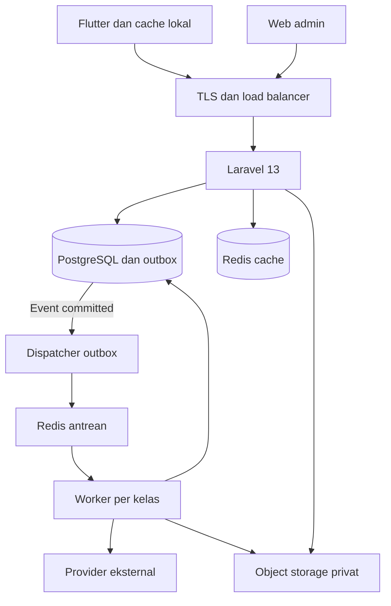

# Technical Requirements Document Laundry SaaS

Versi 1.1 · 28 Oktober 2026 · Status usulan untuk implementasi

[PRD](prd.md) · [TRD](trd.md) · [Database](erd.md) · [UI UX](ui_guidelines.md) · [Aturan AI](agents.md) · [Keamanan](security.md) · [Rencana](todo.md)

## 1 Keputusan teknis dasar

| ADR | Keputusan usulan | Alasan dan konsekuensi |
|---|---|---|
| ADR01 | Modular monolith Laravel 13 | Transaksi inti tetap satu database; batas modul mencegah logika saling menimpa |
| ADR02 | PostgreSQL 18 | Constraint, transaksi, penguncian, dan RLS menjadi dasar integritas |
| ADR03 | Database dan schema bersama untuk tenant awal | Migrasi sederhana; isolasi aplikasi dan database wajib; restore satu tenant perlu prosedur selektif |
| ADR04 | PHP-FPM dan OPcache terlebih dahulu | Runtime mudah dioperasikan; Octane dievaluasi melalui benchmark dan uji state antar tenant |
| ADR05 | REST JSON dan OpenAPI | Kontrak stabil untuk Flutter, web, dan integrasi; spesifikasi OpenAPI dibuat pada fase fondasi |
| ADR06 | Redis antrean terpisah dari Redis cache | Job tidak mengikuti eviction cache; Horizon dipakai untuk pengelolaan worker |
| ADR07 | Flutter MVVM dengan repository | UI terpisah dari API, cache, dan sinkronisasi; state awal memakai Riverpod dan data lokal memakai Drift |
| ADR08 | Outbox dan inbox persisten | Mengatasi retry dan celah proses mati; delivery tetap setidaknya sekali, bukan exactly once |
| ADR09 | Web Blade dan Livewire terpilih | Halaman admin ringan dengan data dipaginasi server; logika bisnis tetap pada application action |

Keputusan adalah baseline proyek, bukan pernyataan bahwa komponen telah terpasang. Laravel 13 memerlukan PHP ≥8.3. Usulan runtime aplikasi adalah PHP 8.4 pada patch keamanan yang didukung; pin versi pasti setelah CI kompatibilitas. Flutter memakai stable yang kompatibel dengan plugin terpilih dan dikunci dalam toolchain proyek. Versi minor Redis, Livewire, Riverpod, Drift, dan plugin ditetapkan dalam lockfile, bukan diperkirakan dari dokumen ini.

### Baseline implementasi fondasi, 31 Oktober 2026

T001 mengesahkan DEC01/DEC02 pada PRD. T007 mempertahankan Laravel di root, menginisialisasi Git lokal `main`, dan menetapkan proyek staf berikutnya di `mobile/`. Pin toolchain berada pada `.php-version`, `.node-version`, `.flutter-version`, `composer.lock`, dan `package-lock.json`: PHP 8.4.27, Node 26.5.0/npm 12.0.1, Flutter 3.44.8/Dart 3.12.2. Paket terpasang meliputi Sanctum 4.3.3, Horizon 5.50.1, Livewire 4.4.8, Flysystem S3 3.35.3, dan Predis 3.7.0.

Compose lokal/test memakai PostgreSQL 18, dua instance Redis 8, serta SeaweedFS 4.50 sebagai endpoint S3-compatible; image dipin digest. SeaweedFS hanya alat storage lokal/test dan tidak mengubah kontrak S3 atau menetapkan provider produksi. `project:prepare` membuat kredensial acak serta konfigurasi `.env.local`/`.env.testing` tanpa menimpa `.env` pengguna. Role migration/runtime terpisah; PHPUnit memakai database `netclean_test`. Petunjuk command tersedia pada README. Bukti T007 adalah verifikasi lokal; workflow remote, image penuh, rollout staging, dan produksi tidak dianggap telah dijalankan.

Penutupan T007 masih menunggu aktivasi permission filesystem NTFS host. Setup kini gagal tertutup ketika mode 0600/0700 tidak diterapkan; jalur sukses diuji pada direktori ext4 terisolasi dan isi kredensial lama dipertahankan. Pengguna mengotorisasi konfigurasi `/etc/fstab` dengan backup serta validasi, tetapi aktivasi mount menunggu restart/mount ulang di luar sesi aktif. Detail bukti dan blocker berada pada backlog.

Artefak kontrak T073 tersedia pada [openapi.yaml](openapi.yaml): 46 path/56 operasi dengan penanda P0/P1, autentikasi perangkat, MFA, reset password, provisioning tenant, entitlement/langganan, assignment membership idempoten, konfigurasi cabang, kalender cabang, preview tenggat, pelanggan/alamat, histori pelanggan, consent, katalog layanan/workflow, price book bertanggal, resolusi harga, publikasi layanan, tipe data, idempotensi, pagination, dan error envelope. Validasi menggunakan Swagger Parser 13.1.0. Schema/model/factory organisasi T008, login/MFA/perangkat T010, otorisasi tenant T011, RLS T013, audit T014, command receipt T017, outbox T018, konfigurasi cabang T012, pelanggan T023, provisioning T009, kuota T015, katalog T021, harga T022, tenggat T025, acceptance order T026, serta histori/consent T024 serta approval diskon T030 tahap pertama sudah diuji pada PostgreSQL 18.

### Aliran komponen



Panah outbox menunjukkan aliran data yang dibaca dispatcher, bukan database memanggil provider secara langsung. API dan worker memakai aturan bisnis serta tenant context yang sama, tetapi dapat diskalakan sebagai proses berbeda.

## 2 TR01 Konteks tenant dan permintaan

Rujukan: FR01–FR06, FR37, NFR09; [security.md](security.md).

Urutan request: autentikasi → resolusi tenant dari `X-Tenant-ID` publik → verifikasi membership aktif → cek entitlement → resolusi scope cabang atau lokasi → Policy tindakan dan objek → validasi → application action → transaksi database → API Resource. Header tenant bukan bukti izin. Route web boleh menyimpan pilihan tenant dalam session, tetapi pemeriksaan server tetap sama.

`TenantContext` immutable berisi tenant internal ID, public ID, membership ID, permission version, dan scope yang sah. Gunakan binding request scoped, bukan singleton statis. Job dan CLI tenant selalu membuat konteks sendiri dan membersihkannya pada `finally`. Operasi control plane seperti memilih membership memiliki query yang secara eksplisit terikat user login dan tidak membuka daftar semua tenant.

Transaksi bisnis memasang `set_config('app.tenant_id', internal_id, true)` pada koneksi yang menjalankan query. Semua query data bisnis sensitif berlangsung pada transaksi singkat dengan RLS aktif. Jangan menjalankan panggilan HTTP provider di dalam transaksi tersebut. Konteks hilang setelah commit atau rollback, termasuk saat koneksi dipakai ulang.

## 3 TR02 Batas modul dan struktur kode

| Modul | Kepemilikan utama | Interface yang dipanggil modul lain |
|---|---|---|
| Identity dan Tenancy | Membership, cabang, lokasi, izin | `AuthorizeContext`, `CheckEntitlement` |
| Catalog dan Pricing | Layanan, daftar harga, workflow | `CreateQuote`, `ResolvePrice` |
| Customer | Pelanggan, alamat, consent | `FindCustomer`, `GetCustomerSnapshot` |
| Order | Pesanan, line, label, revisi | `AcceptOrder`, `ReviseOrder`, `CancelOrder` |
| Production | Tugas, batch, QC, rewash | `TransitionTask`, `EvaluateReadiness` |
| Logistics | Bag, manifest, custody, kurir, handover | `DispatchTransfer`, `ReceiveTransfer`, `HandOverBags` |
| Billing dan Payment | Invoice, adjustment, attempt, penerimaan, refund | `IssueInvoice`, `RecordPayment`, `RequestRefund` |
| Cash | Shift, laci, setoran, biaya | `PostCashMovement`, `CloseCashSession` |
| SaaS Subscription | Paket, langganan, tagihan platform | `GetEntitlements`, `ActivateSubscription` |
| Reporting dan Integration | Ringkasan, ekspor, adapter, notifikasi | `RequestExport`, `PublishBusinessEvent` |

Struktur direktori yang diusulkan:

```text
backend/app/Modules/<Module>/Actions/
backend/app/Modules/<Module>/Data/
backend/app/Modules/<Module>/Models/
backend/app/Modules/<Module>/Policies/
backend/app/Modules/<Module>/Queries/
backend/app/Http/Controllers/Api/V1/
backend/app/Support/Tenancy/
backend/app/Support/Idempotency/
backend/app/Support/Outbox/
backend/tests/Feature/
backend/tests/Integration/
mobile/lib/core/
mobile/lib/features/<feature>/presentation/
mobile/lib/features/<feature>/data/
mobile/lib/features/<feature>/domain/
docs/
```

Nama tersebut rancangan repositori, belum merupakan file implementasi yang tersedia. Controller, Livewire component, dan command CLI memanggil action yang sama; semuanya tidak menulis ledger melalui jalur berbeda. Gunakan Eloquent dan query object seperlunya; jangan membuat repository generik yang hanya membungkus seluruh fungsi ORM tanpa kebutuhan.

## 4 TR03 Kontrak REST

Prefix API `/api/v1`. ID eksternal selalu UUID string; bigint internal tidak menjadi kontrak klien. Nilai uang memakai integer rupiah, kuantitas decimal dikirim sebagai string, dan waktu ISO 8601 UTC. Seluruh daftar mendukung batas page yang dipaksakan server. Default 25, maksimum 100; laporan besar masuk ekspor asynchronous.

Header mobile: `Authorization: Bearer <token>`, `X-Tenant-ID: <tenant-public-id>`, `Accept: application/json`. Perintah mutasi kritis memakai `Idempotency-Key` UUID yang sama dengan `client_command_id` pada payload. Jika keduanya dikirim dan tidak sama, hasil 422. `X-Correlation-ID` boleh diberikan klien dengan validasi format; server menyediakan nilai jika tidak ada.

| Endpoint sesudah prefix | Semantik dan respons |
|---|---|
| `POST /auth/tokens` | Penerbitan token perangkat; tanpa tenant context awal |
| `GET /me/context` | Membership serta cabang atau lokasi yang boleh dipilih |
| `GET /customers?q=...` | Pencarian terisolasi; tidak mengembalikan seluruh histori |
| `POST /orders/quotes` | Penawaran server, default masa berlaku usulan 15 menit |
| `POST /orders` | Satu penerimaan atomik; 201 baru, 200 replay |
| `GET /orders?cursor=...` | Urutan `(created_at,id)` yang stabil |
| `GET /orders/{id}` | Detail terpilih; bagian besar dipaginasi |
| `POST /tasks/{id}/transitions` | Prasyarat, lokasi, dan expected version wajib diperiksa |
| `POST /transfers` | Membuat manifest draft |
| `POST /transfers/{id}/dispatch` | Mengunci bag dan mencatat keberangkatan |
| `POST /transfers/{id}/receipts` | Penerimaan unit yang benar benar tiba |
| `POST /invoices/{id}/payments` | Tunai final atomik atau payment attempt digital pending |
| `POST /payments/{id}/refunds` | Permintaan dan reservasi refund, bukan sukses provider otomatis |
| `POST /orders/{id}/handovers` | Pengambilan bag dan bukti penerima |
| `POST /cash-sessions/{id}/close` | Saldo, kas fisik, alasan selisih, dan versi |
| `POST /sync/commands` | Hasil per command; batch tidak dianggap satu transaksi global |
| `GET /sync/changes` | Delta terbatas pada scope, versi cursor, dan watermark server; P1 |
| `POST /reports/exports` | 202 dan job ID; polling hasil berizin |
| `POST /webhooks/payments/{account-public-id}` | Jalur provider dengan autentikasi provider, tanpa token staf |

Contoh penerimaan berdasarkan penawaran yang telah dihitung server:

```json
{
  "client_command_id": "ca2266e6-f533-4d3b-9a70-d22d834220a1",
  "quote_id": "e136d371-631c-4588-8505-f4454767916e",
  "branch_id": "730b5a9a-53b5-43d5-bdba-85a17667cb16",
  "customer_id": "5fb6c2dc-67dc-40f8-967f-5d0f77f9f8af",
  "lines": [
    {"service_id": "3a426bba-bc8f-4e41-9917-252bc9d8cac0", "measured_quantity": "2.300"},
    {"service_id": "7457f204-523b-477c-9ca2-94f5388a20f1", "measured_quantity": "2.000"}
  ],
  "fulfillment_method": "pickup"
}
```

Diskon, biaya antar, dan tenggat sudah berada dalam quote yang disetujui. Server memverifikasi bahwa pelanggan, cabang, lines, serta fulfillment cocok; klien tidak menimpa harga melalui payload. Draft yang berubah memerlukan quote baru. `customer_id` nullable hanya untuk walk in dengan snapshot identitas minimum yang disepakati.

Contoh respons bisnis, dengan IDs sintetis:

```json
{
  "data": {
    "order_id": "37617ead-0d0e-45de-8369-f8736f66e6be",
    "order_number": "JBI01-20261028-000123",
    "operational_status": "accepted",
    "invoice_status": "unpaid",
    "total_rupiah": 71600,
    "paid_rupiah": 0,
    "balance_due_rupiah": 71600,
    "version": 1
  },
  "meta": {"idempotent_replay": false, "correlation_id": "demo-request-001"}
}
```

Pembayaran DP adalah command terpisah. Gunakan 401 untuk autentikasi, 403 untuk aksi terlarang, 404 untuk objek yang tidak tersedia dalam scope, 409 untuk konflik, 422 untuk validasi, dan 429 disertai `Retry-After` untuk rate limit. Stack trace dan detail schema tidak keluar ke klien. Error body:

```json
{
  "error": {
    "code": "VERSION_CONFLICT",
    "message": "Data sudah berubah. Muat versi terbaru sebelum melanjutkan.",
    "field_errors": {},
    "current_version": 4
  },
  "meta": {"correlation_id": "demo-request-002"}
}
```

Kode domain minimum: `QUOTE_EXPIRED`, `VERSION_CONFLICT`, `ALREADY_HANDED_OVER`, `BAG_IN_TRANSIT`, `PAYMENT_RECONCILIATION_REQUIRED`, `ENTITLEMENT_LIMIT_REACHED`, `IDEMPOTENCY_PAYLOAD_MISMATCH`, `SYNC_CURSOR_EXPIRED`, `SYNC_SCOPE_CHANGED`.

## 5 TR04 Penyimpanan dan konsistensi

Schema normatif berada pada [erd.md](erd.md). Semua relasi tenant memakai FK gabungan tenant dan parent. Perubahan tenant ID pada record terlarang. Master dinonaktifkan; transaksi yang sudah diterbitkan menggunakan snapshot dan koreksi append only. Gunakan index berdasarkan pola query, bukan index semua kolom.

PostgreSQL utama melayani semua pemeriksaan saldo, hak penyerahan, dan batas kredit. Replica baca hanya untuk data yang boleh tertunda. Request yang baru menulis lalu membaca harus memakai primary atau mekanisme read your writes yang terbukti. Lock rows dalam urutan ID konsisten. Retry deadlock dibatasi dan mengulangi seluruh transaksi tanpa mengulangi side effect eksternal.

### Penerimaan pesanan

1. Periksa autentikasi, tenant, izin, dan entitlement.
2. Reservasikan command receipt beserta hash immutable pada transaksi singkat yang durable. Unique key menetapkan hash pertama; status awal processing. Dengan demikian payload berbeda tetap ditolak sekalipun command pertama kemudian gagal validasi bisnis.
3. Jika receipt sudah berhasil, otorisasi ulang objek hasil sebelum mengembalikan replay; jangan menolak karena quote hasil lama kini kedaluwarsa.
4. Pada transaksi bisnis, lock command receipt lebih dahulu, lalu validasi quote untuk command baru, lock quote agar tidak dipakai oleh dua penerimaan berbeda, dan validasi batas penggunaan promo. Retry yang menunggu lock memeriksa kembali status setelah memperoleh lock.
5. Buat order, line, invoice, unit fisik, audit, serta outbox. Nomor nota diperoleh dari counter atomik.
6. Simpan referensi hasil pada command receipt; commit sebelum respons.

Jangan membuat status receipt berhasil sebelum transaksi bisnis commit. Reservasi awal boleh tetap processing jika proses mati; retry dengan payload sama mengambil row lock dan melanjutkan jika belum ada hasil. Hasil bisnis dan receipt completed selalu commit bersama. Penolakan domain terminal dicatat sebagai rejected dengan error code tanpa efek bisnis; gangguan transient tidak dipalsukan menjadi penolakan final. Key rejected tidak dipakai ulang untuk payload baru.

Pengulangan key dengan payload berbeda menghasilkan 409. Canonical payload hash memakai field bisnis yang telah dinormalisasi, termasuk versi; correlation ID dan urutan key JSON tidak mengubah hash. Jangan menampilkan hasil key lama kepada user yang kehilangan izin. Jangan menunggu provider HTTP sambil memegang row lock receipt; command payment hanya membuat intent, lalu mekanisme provider melanjutkan di luar transaksi panjang.

Implementasi T017 menyediakan `command_receipts` dengan unique tenant+client command, hash kanonis, status terminal, RLS tenant, dan result resource allowlist. `CommandReceiptService` mereservasi receipt, mengunci receipt pada transaksi bisnis, memanggil ulang otorisasi saat replay, dan mengembalikan resource melalui resolver. Endpoint assignment membership memakai header `Idempotency-Key` wajib yang sama dengan payload. Reservasi saat ini berada dalam transaksi request tenant sehingga durability crash penuh dan pruning retensi belum diselesaikan; hal ini tetap dicatat sebagai gap T017 dan menjadi masukan T018/T020.

## 6 TR05 Autentikasi dan otorisasi

Sanctum digunakan untuk token mobile per perangkat. Set expiry eksplisit, usulan 12 jam untuk staf, dan pencabutan per perangkat. Sanctum tidak memberikan refresh token OAuth bawaan; pilih autentikasi ulang atau desain refresh terpisah yang direview. Web pihak pertama memakai session cookie aman serta CSRF. Token ability membatasi token tetapi tidak menggantikan Policy objek.

Baseline implementasi T010: token perangkat memakai UUID instalasi yang di-hash, expiry 12 jam, hash SHA-256 di server, daftar sesi aktif, dan pencabutan yang menghapus token serta menandai perangkat revoked. Login memakai pesan generik dan dummy hash; reset password tidak membocorkan keberadaan akun serta mencabut token, perangkat, dan sesi lama. Sesi web memakai CSRF, regenerasi session, cookie HttpOnly/Secure sesuai environment, dan `auth.session` untuk invalidasi setelah perubahan password.

MFA diwajibkan untuk pemilik dan admin platform sebelum akses produksi. Tindakan sensitif memerlukan autentikasi baru sesuai kebijakan. Permission dan assignment dibaca dengan version yang dibatalkan saat berubah; hindari izin lama yang tersimpan berjam jam dalam cache. Penghapusan membership menonaktifkan akses, bukan menghapus actor pada histori transaksi.

Implementasi T010 memakai TOTP melalui `spomky-labs/otphp` 11.5.0 dengan secret terenkripsi, window satu periode, penolakan replay melalui cache 90 detik, recovery code acak yang di-hash dan sekali pakai, serta regenerasi recovery code yang memerlukan password. Pemilik ditentukan dari role code `owner`; platform admin memakai flag eksplisit. Role owner tetap dibuat oleh provisioning T009. Audit pemulihan MFA menyusul T014, dan UUID instalasi bukan cryptographic proof-of-possession.

Implementasi T011 menambahkan `TenantContext` immutable dan `MembershipAuthorizer` yang menyusun permission serta scope cabang/lokasi dari membership aktif. Cache otorisasi memakai permission version, dan action assignment/role-permission menaikkan versi tersebut secara atomik. Policy cabang, lokasi, membership, dan role sudah terdaftar pada Gate; binding konteks per request serta RLS database dilengkapi T013.

Implementasi T013 mengaktifkan RLS pada tabel tenant dan join assignment. `TenantScope` memakai transaksi dengan `set_config` lokal untuk tenant/user context; mode identity dibatasi pada membership dan tenant aktif milik pengguna untuk bootstrap `/me/context`. Middleware `tenant` memvalidasi `X-Tenant-ID`, membangun `TenantContext`, dan menolak konteks di luar membership. Runtime role tetap non-owner tanpa BYPASSRLS; pengujian membuktikan akses tanpa konteks, cross-tenant raw query, koneksi ulang, worker, dan API scoped. Tabel bisnis baru wajib menambahkan policy RLS saat dibuat.

Implementasi T014 menambahkan `audit_logs` append-only dengan RLS tenant. `AuditRecorder` mencatat actor user/membership, action, subject type allowlist, subject public ID, correlation ID, perubahan yang diredaksi, dan alasan. Perubahan assignment serta permission role menulis audit di transaksi yang sama; role runtime hanya dapat membaca/menulis audit, bukan mengubah atau menghapusnya. Event autentikasi tenant, retensi terpisah, dan `platform_audit_logs` tetap mengikuti task terkait.

## 7 TR06 Keuangan dan integrasi pembayaran

Rujukan: BR04–BR06, FR31–FR36, FR38; rumus dan tabel berada pada [erd.md](erd.md).

Pisahkan invoice, payment attempt, payment, alokasi, adjustment, refund, dan kas. Pembayaran tunai berhasil membuat payment, allocation, cash entry, audit, serta outbox dalam satu transaksi. Kelebihan tunai yang dibayar pelanggan dibedakan dari uang diserahkan ke kasir dan kembalian: payment hanya sebesar dana bersih yang benar benar diterima; kelebihan yang sengaja dititipkan menjadi unallocated credit.

Untuk pembayaran digital: simpan intent dan external reference dahulu → panggil provider di luar transaksi panjang dengan idempotency reference yang tetap → simpan hasil atau pending rekonsiliasi → validasi webhook atau status provider → post payment satu kali. Timeout tidak berarti gagal. Redirect dan callback Flutter hanya memicu pengecekan status server.

Webhook memetakan account publik ke merchant server sebelum memverifikasi tanda tangan; tenant tidak dipercaya dari body. Simpan inbox terautentikasi dengan dedup key sebelum memberi 2xx. Jika penyimpanan durable gagal, kembalikan kegagalan agar provider dapat retry. Jika pemrosesan bisnis asynchronous gagal sesudah 2xx, retry internal wajib memulihkannya.

Periksa order reference, merchant, amount, currency bila ada, serta status resmi provider. Untuk Midtrans gunakan autentikasi yang didokumentasikan, bukan HMAC generik yang diasumsikan sama untuk semua provider. Event pending yang tiba sesudah settlement tidak menurunkan payment. Refund dan dispute merupakan peristiwa berbeda. Rekonsiliasi berkala membandingkan ledger dengan provider atau laporan settlement.

Refund mengunci payment asal, menghitung succeeded ditambah reserved refund, lalu mencadangkan jumlah. Jika provider timeout, refund tetap processing atau perlu rekonsiliasi; jangan melepaskan reservasi sebelum kepastian hasil. Credit note tidak otomatis berarti refund sudah terjadi. Langganan SaaS memakai tabel dan merchant platform terpisah dari uang laundry.

## 8 TR07 Produksi dan transfer

Tugas produksi tertaut pada bag content dan snapshot tahap. Prasyarat dicek server; seluruh tahap wajib selesai atau dilewati dengan alasan dan izin yang sah sebelum QC. Batch allocation tidak mengubah kuantitas tagihan. Rewash membuat attempt atau tugas baru yang menunjuk pekerjaan asal, sehingga histori pertama tetap ada.

Dispatch transfer mengunci semua bag terpilih, memeriksa lokasi asal dan tidak adanya transfer aktif, lalu memperbarui custody menjadi in transit. Receive mengunci bag serta transfer line, mencatat hanya unit diterima, dan menutup custody perjalanan untuk unit tersebut. Header manifest diturunkan dari line. Konflik atau selisih tidak diselesaikan dengan mengubah jumlah historis pengirim.

Handover memeriksa lokasi fisik, QC, kuantitas tersisa, dan syarat bayar atau credit approval. P0 menyerahkan bag utuh; pengambilan sebagian pesanan berarti sebagian bag. Repack memindahkan isi dengan event yang menjaga total fisik sebelum mencetak label baru. Order completed dihitung dari seluruh bagian yang aktif, bukan dari tombol selesai bebas.

## 9 TR08 Arsitektur Flutter dan sinkronisasi

View hanya menangani presentasi, gesture, dan layout. ViewModel atau controller mengubah event menjadi command dan UI state. Repository menggabungkan API, database lokal, retry, serta invalidasi. Use case dipakai untuk proses lintas repository yang memang kompleks. Pola state proyek memakai Riverpod secara konsisten; perubahan ke Bloc atau pendekatan lain perlu keputusan tim, bukan campuran per layar tanpa alasan.

Data lokal dipisahkan menurut tenant dan user. Cache hanya menyimpan katalog, pelanggan yang relevan, dan pekerjaan aktif sesuai izin. Token berada pada storage aman sistem operasi. Drift tidak berarti seluruh database otomatis terenkripsi; implementasi perlindungan lokal harus dipilih dan diuji sesuai [security.md](security.md).

### P0 draft dan replay

- Simpan draft, command UUID, payload, referensi lokal, versi objek, dependensi command, waktu perangkat, dan status secara durable.
- Draft belum memiliki nomor nota server. Aplikasi tahan restart dan menampilkan jumlah command tertunda.
- Buat atau validasi quote saat online, lalu kirim command. Jika harga berubah, staf menyetujui quote baru dan membuat command baru; command lama yang ditolak tidak diubah menjadi payload berbeda.
- Sinkronisasi saat aplikasi aktif, koneksi pulih, atau pengguna memilih sinkronkan. Background task bersifat upaya terbaik, bukan jaminan OS.
- 401 menghentikan antrean sampai login; 403 atau pencabutan membership mengunci data konteks; 409 meminta resolusi; 429 menunggu retry; timeout mengulang key sama.
- Command yang bergantung pada command gagal tidak dikirim sampai dependensinya diselesaikan. Satu batch mengembalikan hasil per item dan tidak menjanjikan semua item atomik.

### P1 change feed

Cursor harus terikat tenant, user atau scope, generation, dan sequence server. Jangan memakai `updated_at` perangkat atau ID sequence yang dapat committed tidak berurutan tanpa perlindungan. Baseline schema menyediakan counter per tenant yang dikunci saat append change feed pada transaksi yang sama. Lock ini diambil terakhir dan tidak diikuti lock objek bisnis lain; throughput per tenant diuji.

Bootstrap menyediakan snapshot konsisten beserta watermark pada dataset kerja yang dibatasi. Untuk pagination lintas request, materialisasikan snapshot sementara atau gunakan mekanisme snapshot yang terbukti; jangan mencampurkan watermark baru dengan page lama. Sesudah bootstrap, ambil perubahan di atas watermark. Penghapusan atau pencabutan objek menghasilkan tombstone. Perubahan scope memaksa purge atau bootstrap ulang; cursor kedaluwarsa menghasilkan 409 `SYNC_CURSOR_EXPIRED`. Jangan membiarkan cache lama memperluas akses sesudah server mencabut scope.

## 10 TR09 Outbox inbox dan efek eksternal

Outbox ditulis bersama perubahan bisnis. Dispatcher mengambil event menggunakan claim atau lease yang dapat pulih, menerbitkan job, kemudian menandai waktu dispatch. Mati sesudah publish sebelum penandaan dapat menghasilkan job ganda; consumer wajib idempoten.

Efek database dan receipt consumer ditulis pada transaksi yang sama dengan unique `(tenant_id, consumer_name, event_id)`. Jangan mencatat receipt sukses dahulu lalu menjalankan efek pada transaksi terpisah. Event yang terdispatch tetapi belum memiliki receipt setelah batas waktu dapat diterbitkan ulang melalui rekonsiliasi; `dispatched_at` saja bukan bukti bahwa efek selesai.

Untuk HTTP eksternal, buat delivery intent yang unik dan gunakan reference tetap pada provider yang mendukung idempotensi. Jika provider tidak mendukungnya, kegagalan setelah provider menerima permintaan memiliki hasil tidak pasti; rekonsiliasi atau intervensi diperlukan. Jangan mengklaim pesan eksternal tidak mungkin duplikat. Side effect uang memakai state machine dan rekonsiliasi khusus Payment.

Implementasi T018 menambahkan `outbox_events`, `event_deliveries`, dan `consumer_receipts` dengan RLS tenant. `OutboxWriter` menulis event serta delivery dalam transaksi bisnis; `OutboxDispatcher` meng-claim dengan lease dan `FOR UPDATE SKIP LOCKED`, lalu mengirim job setelah commit. Consumer menulis efek database dan receipt pada transaksi yang sama, sehingga replay job atau dispatch ulang tidak menggandakan efek. Delivery tanpa receipt dapat diambil kembali setelah lease kedaluwarsa. Consumer bisnis nyata, retensi, metrik backlog, dan scheduler dispatcher masih menjadi pekerjaan lanjutan T019/T020.

Implementasi T012 menambahkan endpoint konfigurasi cabang dalam tenant context. Perubahan profil/status menaikkan version, menulis audit dengan alasan, dan tidak mengubah kode, tenant, atau waktu pembuatan. Guard `EnsureBranchAcceptsOrders` menolak cabang nonaktif serta tenant tidak aktif; task order wajib memanggil guard ini sebelum menerima pesanan.

Implementasi T023 menambahkan pelanggan dan alamat tenant-scoped dengan RLS, normalisasi nomor Indonesia, pencarian nama/telepon cursor, kandidat duplikat per tenant, dan satu alamat default per pelanggan. Permission `customers.view`/`customers.manage` dipisahkan. Pencarian saat ini substring sederhana; fuzzy ranking, import, consent, dan audit PII mengikuti task berikutnya.

Implementasi T009 menyediakan provisioning tenant untuk pemilik yang sudah login. `provisioning_requests` melakukan deduplikasi per user+client command di control plane; `ProvisioningScope` menetapkan user context dan tenant context setelah ID tenant dialokasikan. Service membuat tenant aktif, cabang awal, role owner sistem dengan seluruh permission, membership owner, dan assignment. Trial/entitlement serta onboarding state terpisah belum dibuat.

Implementasi T015 menambahkan plan versioned, subscription tenant dengan snapshot entitlement, dan counter kuota tenant+metric+period. `ConsumeQuota` memakai update bersyarat atomik sehingga slot terakhir tidak dapat diberikan dua kali; `SubscriptionEntitlements` menolak fitur berbayar dan subscription nonaktif. Endpoint `GET /me/subscription` mengekspos limit/fitur efektif. Plan admin UI, harga final, trial default, dan integrasi kuota staf menunggu task berikutnya.

Implementasi T002 menyediakan fixture harga/kalender pada `docs/fixtures/pricing-calendar.json`. Fixture menetapkan minimum/step kiloan, harga default dan override cabang, express +50% setelah diskon layanan, antar yang tidak didiskon, quote 15 menit, cut-off 15.00, hari kerja/libur, serta contoh BR05 Rp71.600. T021/T022/T025/T026 wajib memakai fixture ini dan tidak boleh mengubah perilaku tarif tanpa keputusan baru.

Implementasi T021 menyediakan API katalog tenant untuk layanan dan workflow versioned. Definisi workflow tidak dapat diedit atau dihapus melalui role runtime; perubahan tahapan selalu membuat revision baru dan revision sebelumnya hanya dinonaktifkan. `CaptureServiceSnapshot` menjadi boundary untuk T026 agar perubahan layanan berikutnya tidak mengubah order lama. Layanan tetap draft sampai T022 membuktikan harga efektif valid sebelum publikasi.

Implementasi T022 menambahkan price book tenant/cabang dan entry harga bertanggal dengan tier regular/express. Satu book aktif per scope dijaga unique index parsial; periode entry memakai rentang setengah terbuka dan exclusion constraint `btree_gist` sehingga overlap ditolak juga saat request serentak. Advisory lock per book+layanan+tier menjaga urutan cek dan tulis. `ResolvePrice` memilih book cabang aktif lebih dulu, lalu book tenant, dan mengembalikan sumber serta entry yang dipakai. Publikasi layanan mensyaratkan workflow revision aktif dan tarif regular tenant yang efektif; perubahan status publikasi dicatat audit. Harga khusus pelanggan dan snapshot quote tetap menjadi pekerjaan P1/T026.

Implementasi T025 menambahkan kalender cabang (`weekly_hours`, `holiday`, `cutoff`), field SLA layanan (`working_days` atau `elapsed_hours` beserta turnaround reguler/express), endpoint preview tenggat, dan `CalculateDeadline`. Mode `working_days` memakai cut-off, jadwal, dan libur; mode `elapsed_hours` memakai waktu dinding sehingga 24 jam tidak disamakan dengan satu hari kerja. `RecordDeadlinePromise`, `ReviseDeadlinePromise`, dan `GetDeadlinePromise` menyimpan serta membaca janji awal/revisi append-only pada audit dengan actor dan reason; T026 akan mengaitkan promise ID dengan order. Kalender baru mengganti konfigurasi atomik, menaikkan version cabang, dan tidak menghitung ulang due date order lama.

Implementasi T026 menambahkan quote server dan acceptance atomik. `CreateQuote` memakai `ResolvePrice` dan `CalculateDeadline` per line, menghitung billable quantity dari minimum/step dengan integer thousandths, mengalokasikan diskon layanan, menerapkan express setelah diskon, dan menambahkan biaya antar yang tidak didiskon. Quote menyimpan request hash, pricing snapshot, expiry 15 menit, dan due_at. `AcceptOrder` mengunci quote, memvalidasi hash/expiry, membuat order, line, invoice, invoice line, bag/contents awal, event accepted, nomor order/invoice atomik, audit, dan outbox dalam transaksi yang sama. `CommandReceiptService` menjadi replay path sehingga retry setelah commit tidak memeriksa expiry quote lama. Pembayaran, nota, dan revisi jadwal tetap task berikutnya.

Implementasi T024 menambahkan `customer_consents` append-only dengan RLS dan enum purpose/channel/decision. Histori order pelanggan memakai cursor `(created_at,id)`, dibatasi tenant dan permission `customers.view` + `orders.view`; consent terbaru diturunkan per purpose+channel dari event, sehingga marketing dan pemberitahuan layanan tidak saling menimpa. Riwayat event lengkap belum diekspos sebagai endpoint; pengiriman notifikasi dan retensi mengikuti T077/T045.

Implementasi T030 tahap diskon menambahkan permission `discounts.standard` dan `discounts.override`, tabel `discount_approvals`, auto-approval sampai 10%, approval owner berbeda aktor untuk diskon lebih tinggi, dan pemeriksaan approval pada acceptance quote. Revisi order, snapshot versi lama, dan debit/credit note belum diimplementasikan; T030 tetap terbuka.

## 11 TR10 Antrean scheduler dan cache

| Kelas | Jenis pekerjaan | Usulan timeout dan kebijakan |
|---|---|---|
| `payments` | Pemrosesan inbox dan rekonsiliasi | 30 detik per job; provider call lebih singkat; prioritas tinggi |
| `operations` | Outbox dan perubahan status turunan | 30 detik; idempotensi database |
| `notifications` | Pesan dan push | 30 detik; rate limit provider dan delivery intent |
| `exports` | CSV atau dokumen besar | 300 detik; streaming atau chunk; concurrency rendah |

Pisahkan supervisor kelas panjang dan pendek. Konfigurasi queue `retry_after` harus lebih besar daripada job timeout beserta margin; usulan awal 90 detik untuk kelas 30 detik dan 360 detik untuk kelas ekspor 300 detik pada koneksi berbeda. Timeout Horizon atau proses harus selaras. Uji worker terbunuh dan lease habis sebelum menganggap konfigurasi aman.

Retry memakai exponential backoff dan jitter dengan batas usaha, lalu failed jobs yang dapat diperiksa serta diulang terkontrol. Provider rate limit tidak diatasi dengan menambah worker tanpa batas. Redis antrean memakai persistence, akses privat, dan kebijakan no eviction yang sesuai; kapasitas dipantau. Horizon memerlukan Redis dan tidak kompatibel dengan Redis Cluster menurut dokumentasinya; jangan memilih cluster tersebut untuk antrean ini tanpa perubahan pendekatan yang tervalidasi.

Cache key mencakup tenant, cabang atau scope, versi, serta locale jika memengaruhi hasil. Usulan TTL katalog lima menit dengan invalidasi setelah commit; dashboard 30–60 detik dengan waktu pembaruan terlihat. Jangan memakai cache untuk mengesahkan saldo, batas refund, atau sisa penyerahan. Scheduler satu pelaksana atau distributed lock yang sah, plus idempotensi job tetap diperlukan.

## 12 TR11 Berkas dan perangkat

Unggahan dipisahkan dari transaksi utama melalui init upload → transfer ke object privat → finalize dengan pemeriksaan ukuran, jenis konten, dan kepemilikan → lampiran siap. File yang belum lolos validasi tidak dapat dibaca pengguna lain. Batas usulan foto lima MB per input; thumbnail dan kompresi mengikuti UI, tanpa menghapus bukti yang dibutuhkan operasional. Original dan thumbnail mempunyai key server, checksum, serta lifecycle. Ekspor keuangan yang memerlukan pencabutan segera diunduh melalui gateway dengan otorisasi tiap request; signed URL foto berumur pendek tetap mempunyai jendela berlaku sampai kedaluwarsa.

Print adapter menerima DTO nota dari hasil transaksi tersimpan. Kegagalan cetak tidak mengulang order atau payment. Catat local print attempt dan tampilkan cetak ulang. Matrix model printer, jenis koneksi, OS, dan ukuran kertas diuji dengan perangkat fisik. Timbangan manual menjadi baseline; integrasi serial atau Bluetooth memerlukan stabilisasi nilai, unit, tare, dan konfirmasi operator. Tidak ada janji seluruh plugin Flutter kompatibel semua platform.

## 13 TR12 Laporan dan definisi data

Penjualan berdasarkan tanggal invoice dan cabang penjualan; penerimaan berdasarkan payment succeeded dan cabang penerimaan; cash shift berdasarkan transaksi tunai yang ditautkan ke shift. Adjustment dan refund ditampilkan pada tanggal posting beserta referensi asal. Jangan menggabungkan konsep tersebut menjadi satu angka pendapatan tanpa label.

Ringkasan harian dapat dibangun ulang dari detail. Tampilkan watermark, zona waktu, basis tanggal, dan filter. Transfer internal bukan penjualan baru. Rekomputasi periode memakai versi ringkasan agar hasil separuh jadi tidak menimpa dashboard. Ekspor CSV melindungi sel yang dapat dieksekusi sebagai formula oleh aplikasi spreadsheet dan tidak memasukkan data yang tidak diizinkan.

## 14 TR13 Deployment dan evolusi

Gunakan image rilis immutable, environment development atau staging atau production, secret terpisah, dan storage eksternal. API tidak menyimpan foto atau state sesi penting di disk lokal. Scheduler, worker, dan API memakai command berbeda dari image yang sama. Docker Compose atau platform container terkelola cukup sebagai titik awal; Kubernetes dipilih bila kebutuhan dan kemampuan operasi mendukung.

| Tahap | Titik awal sizing untuk benchmark |
|---|---|
| Pilot | App dan worker 2 vCPU 4 GB dengan batas proses; database terpisah 2 vCPU 4 GB; Redis queue dan cache; object storage |
| Pertumbuhan | Dua app instance masing masing 2–4 vCPU dan 4–8 GB; worker khusus; database 4 vCPU 16 GB dengan failover |
| Besar | Sizing berdasarkan telemetry; pooling, worker per kelas, replica analitik, opsi database tenant khusus |

Spesifikasi bukan jaminan kapasitas. Uji pilot: 50 tenant, 100 ribu order historis, 20 RPS, 50 virtual users, soak delapan jam. Pertumbuhan: 500 tenant, satu juta order, 100 RPS, 300 virtual users, spike 300 RPS lima menit. Campuran awal 60 persen baca, 20 persen penerimaan, 10 persen produksi, 10 persen pembayaran atau lainnya. Jumlah virtual users bukan RPS; pacing dan endpoint mix harus dicatat.

Pipeline: validasi → test → audit dependensi → build → staging → migrasi expand → deploy bertahap → smoke → observasi. Migrasi berjalan satu pelaksana. Gunakan schema yang kompatibel dengan versi aplikasi lama selama rollout. Setelah rilis, restart atau reload proses berumur panjang melalui mekanisme platform; Horizon dihentikan secara graceful dan supervisor menyalakannya kembali. Jangan menganggap rollback image juga membatalkan perubahan data.

## 15 TR14 Observabilitas dan pemulihan

Log menyertakan correlation ID, release, nama action, durasi, error code, dan identitas actor yang dipseudonimkan bila perlu. Jangan log token, secret, payload foto, alamat lengkap, atau body webhook mentah tanpa perlindungan. Pantau latency, 5xx, query lambat, lock wait, koneksi, CPU, memori, queue age, failed jobs, inbox belum diproses, outbox tanpa receipt, storage, dan umur backup.

Target availability serta RPO dan RTO mengikuti PRD. Usulan backup harian 35 hari dan WAL berkelanjutan untuk PITR; kemampuan penyedia dan interval aktual harus dibuktikan. Restore bulanan dilakukan pada lingkungan terisolasi, mencakup database, file, secret yang diperlukan, serta rekonsiliasi pekerjaan pending. Restore seluruh database bukan cara langsung memulihkan satu tenant tanpa memengaruhi tenant lain.

Runbook lonjakan: kurangi ekspor → cari hambatan → tambah API bila CPU API penuh dan database sehat → tambah worker kelas tertinggal dalam batas provider → tangani lock atau IOPS bila database menjadi hambatan → verifikasi integritas → turunkan kapasitas setelah stabil. Perhitungkan seluruh koneksi API, worker, scheduler, serta cadangan admin sebelum menambah replica.

## 16 TR15 Pengujian dan batas verifikasi

Wajib ada unit test untuk harga serta state machine; integration test PostgreSQL untuk RLS, FK, unique key, penguncian, dan ledger; contract test API; widget dan integration test Flutter; UAT perangkat; load, spike, soak, serta latihan restore. SQLite untuk unit test tidak dapat menggantikan integration test fitur khusus PostgreSQL.

Target NFR01–NFR10 hanya dinyatakan lulus dengan build, environment, dataset, distribusi beban, hasil p95, dan error rate yang dicatat. Dokumentasi saat ini merupakan spesifikasi; tidak ada klaim pengujian aplikasi sudah dijalankan. Bukti tiap fase berada pada backlog [todo.md](todo.md).

## 17 TR16 Perubahan arsitektur

Octane diuji jika profiling membuktikan bootstrap menjadi hambatan. Tenant context, singleton, static state, dan pertumbuhan memori wajib diuji berulang antar tenant. Database tenant tersendiri dipertimbangkan untuk kebutuhan isolasi atau beban yang nyata; resolver dan tooling migrasinya harus ada. Microservices, broker tambahan, serta search engine terpisah hanya diperkenalkan melalui ADR yang menjelaskan masalah, alternatif, biaya operasi, dan rencana pemulihan.

## 18 Sumber resmi

- [Laravel 13 release notes](https://laravel.com/docs/13.x/releases)
- [Deployment](https://laravel.com/docs/13.x/deployment), [Sanctum](https://laravel.com/docs/13.x/sanctum), [queues](https://laravel.com/docs/13.x/queues), [Horizon](https://laravel.com/docs/13.x/horizon)
- [Octane](https://laravel.com/docs/13.x/octane), [scheduling](https://laravel.com/docs/13.x/scheduling), [pagination](https://laravel.com/docs/13.x/pagination)
- [Flutter architecture](https://docs.flutter.dev/app-architecture/guide), [recommendations](https://docs.flutter.dev/app-architecture/recommendations), [offline](https://docs.flutter.dev/app-architecture/design-patterns/offline-first), [performance](https://docs.flutter.dev/perf/best-practices)
- [Riverpod](https://riverpod.dev/), [Drift](https://drift.simonbinder.eu/setup/), [Livewire](https://livewire.laravel.com/docs/installation)
- [Midtrans webhook](https://docs.midtrans.com/docs/https-notification-webhooks)

Sumber menjelaskan kemampuan komponen; ADR, angka target, dan pilihan penerapannya merupakan keputusan rancangan proyek. Kontrak provider dan versi paket diperiksa kembali pada implementasi.
